# Capítulo V: Product Implementation, Validation & Deployment

## 5.1. Software Configuration Management

La Gestión de Configuración de Software (SCM) es la disciplina que permite identificar, controlar, versionar y auditar los distintos componentes de un sistema durante todo su ciclo de vida. Su aplicación asegura la trazabilidad de los cambios realizados sobre el código fuente, la documentación y los artefactos de diseño, reduciendo la probabilidad de errores de integración y facilitando el trabajo colaborativo del equipo.

En el caso de **AgroFlet**, la solución está compuesta por una Landing Page informativa, una Frontend Web Application y un RESTful API de elaboración interna. Durante el **Sprint 1** se priorizó la implementación, validación y despliegue de la primera versión de la **Landing Page**, desarrollada con HTML5, CSS3 y JavaScript (ES6+), manteniendo un comportamiento 100 % responsive y sin dependencias de frameworks externos.

### 5.1.1. Software Development Environment Configuration

A continuación se listan los productos de software utilizados por el equipo, organizados por tipo de actividad del ciclo de vida. Para cada herramienta se indica su propósito dentro de AgroFlet y la ruta de referencia o descarga.

**1. Project Management**

*Descripción:*

La gestión del proyecto permite organizar las actividades necesarias para alcanzar los objetivos del Sprint, asignar responsables, dar seguimiento al avance y mantener la comunicación entre los integrantes del equipo.


**Google Meet:**

Google Meet es la herramienta de videoconferencia empleada para las ceremonias formales de Scrum: Sprint Planning, Daily Meetings y Sprint Review. Permite la coordinación sincrónica del equipo y el registro audiovisual de las sesiones de revisión.

https://meet.google.com/

<p align="center">
  
</p>

**WhatsApp:**

Se emplean como canales de comunicación asincrónica para coordinar avances diarios, resolver bloqueos puntuales y notificar la apertura de Pull Requests pendientes de revisión.

https://whatsapp.com/

<p align="center">
  
</p>

**2. Requirements Management**

**UXPressia:**

UXPressia se utiliza para la elaboración de los User Personas, Empathy Maps, Journey Maps e Impact Maps presentados en los capítulos anteriores, facilitando la identificación de necesidades de los segmentos objetivo (despachadores, transportistas y compradores mayoristas).

https://uxpressia.com/

<p align="center">
  
</p>

**Miro:**

Miro es la pizarra colaborativa utilizada para el Lean UX Canvas, el EventStorming y el diagrama de Arquitectura de la Información del Landing Page.

https://miro.com/

<p align="center">
  
</p>

**3. Product UX/UI Design**

**Figma:**

Figma es la herramienta de diseño colaborativo en la nube empleada para elaborar los wireframes, mockups y prototipos de la Landing Page y de la Web Application, así como para documentar el Design System de AgroFlet (paleta de marca y tipografía Inter). Los diseños allí definidos son la referencia directa de la implementación en HTML5 y CSS3.

https://www.figma.com/

<p align="center">
  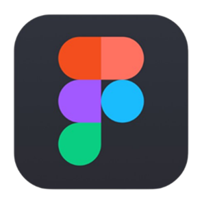
</p>

**Lucidchart:**

Lucidchart se utiliza para la elaboración de Wireflows, User Flows, diagramas UML y el Database Design de la solución.

https://www.lucidchart.com/

<p align="center">
  
</p>

**Structurizr:**

Structurizr se utiliza para la elaboración de los diagramas de arquitectura de software bajo el modelo C4 (Context, Container y Component Level Diagrams) presentados en el Capítulo IV.

https://structurizr.com/

<p align="center">
  
</p>

**4. Software Development**

**Visual Studio Code:**

Visual Studio Code es el editor principal del equipo. Se utiliza para desarrollar los archivos `index.html`, `styles.css`, `app.js` y los diccionarios de internacionalización del proyecto. La configuración de formato se estandariza mediante el archivo `.editorconfig` incluido en la raíz del repositorio.

https://code.visualstudio.com/

<p align="center">
  
</p>

**HTML5 / CSS3 / JavaScript (ES6+):**

Constituyen las tecnologías base de la Landing Page desplegada en el Sprint 1. HTML5 aporta la estructura semántica y accesible; CSS3 implementa el sistema de diseño mediante Custom Properties, CSS Grid y Flexbox bajo un enfoque Mobile-First; y JavaScript aporta la interactividad del lado del cliente sin dependencias externas.

<p align="center">
  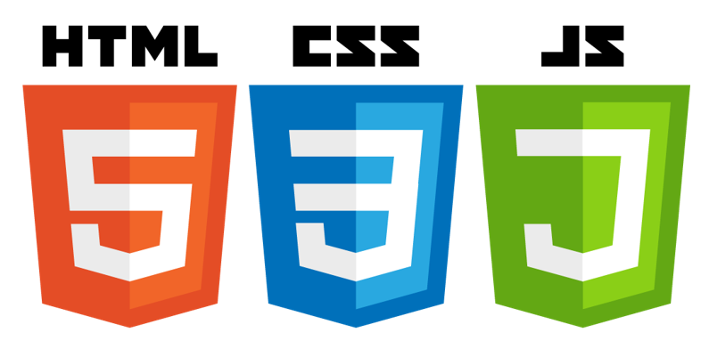
</p>

**Vue.js:**

Vue.js es el framework de JavaScript seleccionado para el desarrollo de la Frontend Web Application (dashboard de monitoreo). Su implementación está planificada para los siguientes Sprints.

https://vuejs.org/

<p align="center">
  
</p>

**PrimeVue:**

PrimeVue es la biblioteca de componentes de interfaz para Vue.js con la que se implementarán las Data Tables, formularios y componentes de navegación del dashboard, de acuerdo con el diseño definido en el Capítulo IV.

https://primevue.org/

<p align="center">
  
</p>

**ASP.NET Core:**

ASP.NET Core es el framework utilizado para el desarrollo del RESTful API de AgroFlet, responsable de la lógica de negocio de los bounded contexts *Fleet Management*, *Shipment Tracking* e *Identity and Access Management*.

https://dotnet.microsoft.com/apps/aspnet

<p align="center">
  
</p>

**C#:**

C# es el lenguaje de programación empleado en la implementación de los Web Services mediante ASP.NET Core y Entity Framework Core.

https://dotnet.microsoft.com/languages/csharp

<p align="center">
  
</p>

**Entity Framework Core:**

Entity Framework Core es el ORM utilizado para la persistencia de usuarios, unidades de transporte, operaciones e incidencias desde el RESTful API hacia la base de datos relacional.

https://learn.microsoft.com/ef/core/

<p align="center">
  
</p>

**MySQL Server:**

MySQL es el sistema de gestión de base de datos relacional (RDBMS) definido en el Container Level Diagram del modelo C4 para almacenar la información operativa de la plataforma.

https://www.mysql.com/

<p align="center">
  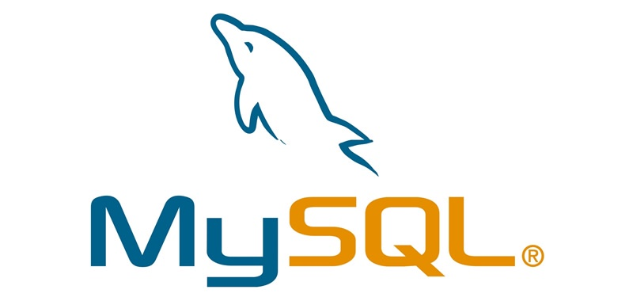
</p>

**Git:**

Git es el sistema de control de versiones distribuido utilizado localmente por cada integrante para registrar cambios, crear ramas y sincronizar el código fuente con el repositorio remoto.

https://git-scm.com/

<p align="center">
  
</p>

**GitHub:**

GitHub es la plataforma de colaboración donde se alojan los repositorios del proyecto. Sobre ella se aplican el flujo GitFlow, las revisiones mediante Pull Requests y el registro de contribuciones por integrante.

https://github.com/

<p align="center">
  
</p>

**5. Software Deployment**

**GitHub Pages:**

GitHub Pages es el servicio de hosting estático utilizado para publicar la versión `v1.0.0` de la Landing Page de AgroFlet directamente desde la rama `main` del repositorio. El archivo `.nojekyll` incluido en la raíz del proyecto deshabilita el procesamiento por Jekyll y garantiza la carga correcta de los directorios de assets.

https://pages.github.com/

<p align="center">
  
</p>

**Proveedor de hosting en la nube para ASP.NET Core:**

Como **propuesta concreta de infraestructura para el Sprint 3 (AV2)**, se plantea **Microsoft Azure App Service** para publicar el RESTful API con ASP.NET Core y **Azure Database for MySQL – Flexible Server** como servicio de persistencia. La alternativa responde a cinco criterios: compatibilidad con el runtime .NET, facilidad de publicación desde GitHub Actions, gestión de configuración y secretos mediante variables de entorno, disponibilidad de HTTPS y diagnósticos de la aplicación, y administración de una base de datos MySQL sin mantener manualmente un servidor de bases de datos. El equipo debe contrastar el costo del plan, la región y los límites de recursos antes de aprovisionarla.

**Distinción entre diseño y operación:** esta es una **selección técnica propuesta y justificada para evaluación del equipo**, no una afirmación de que el backend ya esté publicado en Azure. Al cierre de TB1, la aplicación se demostraba con una Fake API en Vercel; su contrato OpenAPI no sustituye al servicio definitivo. Para acreditar la implementación en AV2 se requerirán el repositorio ASP.NET Core, un servicio desplegado accesible por HTTPS, una conexión MySQL probada, pruebas de endpoints y capturas del portal de hosting y Swagger/OpenAPI.

<p align="center">
  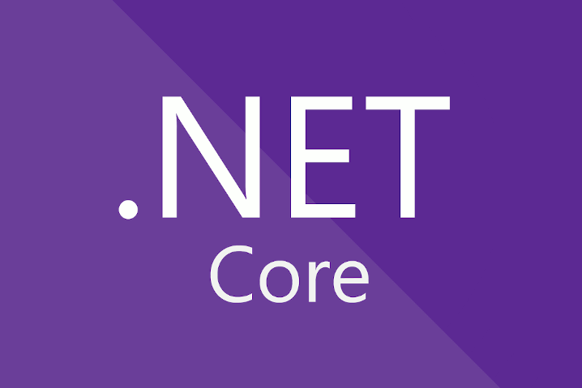
</p>

**6. Software Documentation**

**Markdown + Visual Studio Code:**

Markdown es el formato utilizado para la elaboración del `README.md` del repositorio y de los capítulos del Project Report. Visual Studio Code permite editar y previsualizar dichos archivos antes de publicarlos en GitHub.

<p align="center">
  
</p>

**Swagger / OpenAPI:**

Swagger se utilizará para documentar los endpoints del RESTful API mediante la especificación OpenAPI, permitiendo visualizar e interactuar con los servicios desde una interfaz web. Su uso corresponde a los Sprints en los que se implemente el backend.

https://swagger.io/

<p align="center">
  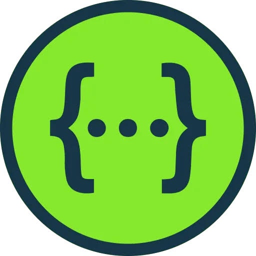
</p>

El entorno seleccionado permite mantener coherencia entre el diseño elaborado en Figma y la implementación web desarrollada por el equipo: Visual Studio Code, Live Server y Chrome DevTools facilitan la construcción y validación local del producto; Git y GitHub aseguran la trazabilidad de los cambios; GitHub Pages permite publicar la solución; y la combinación de Gherkin y Cucumber documenta y ejecuta las pruebas de aceptación asociadas a los requerimientos funcionales.

---

### 5.1.2. Source Code Management

La administración del código fuente es un pilar del trabajo colaborativo del equipo. En este apartado se define el modelo organizativo y de control de versiones aplicado mediante GitHub y el flujo de trabajo GitFlow, junto con las convenciones de nombrado de ramas, estructura de mensajes de commit y versionado semántico de los lanzamientos.

**1. Establecimiento de repositorios en GitHub**

La solución distribuida de AgroFlet se organiza en repositorios independientes, separando las responsabilidades de cada producto:

*Landing Page:* repositorio dedicado al sitio web informativo y promocional del producto. Contiene la totalidad de los recursos estáticos (HTML5, CSS3, JavaScript, diccionarios de internacionalización e imágenes) orientados a comunicar la propuesta de valor de AgroFlet a los segmentos objetivo. En este mismo repositorio se alojarán los archivos `.feature` de las pruebas de aceptación asociadas al landing.

*Frontend Web Application:* repositorio destinado a la aplicación web del lado del cliente desarrollada con Vue.js y PrimeVue. Contiene las vistas, componentes y la lógica de consumo del RESTful API.

*Web Services:* repositorio que aloja la lógica del backend implementada con ASP.NET Core y Entity Framework Core, incluyendo las pruebas unitarias, de integración y de aceptación.

*Project Report:* repositorio destinado a la redacción y versionamiento de los capítulos del informe del proyecto en formato Markdown.

**Enlaces a los repositorios:**

* Repositorio de Landing Page: `[https://github.com/<organizacion>/agroflet-landing-page]`
* Repositorio de Frontend Web Application: Disponible en futuras entregas
* Repositorio de Web Services: Disponible en futuras entregas
* Repositorio del Project Report: `[https://github.com/<organizacion>/agroflet-project-report]`

**2. Estructura del repositorio de la Landing Page**

La organización de directorios sigue una arquitectura modular y desacoplada, separando estilos, scripts, diccionarios de idioma y recursos gráficos:

```text
agroflet-landing-page/
├── assets/
│   ├── css/
│   │   └── styles.css              # Design tokens, layouts y componentes
│   ├── i18n/
│   │   ├── es.json                 # Diccionario de traducción en español
│   │   └── en.json                 # Diccionario de traducción en inglés
│   ├── js/
│   │   └── app.js                  # Interactividad, validaciones, i18n y carrusel
│   └── images/
│       ├── logo.jpg                # Identidad visual oficial
│       └── team/                   # Fotografías de los integrantes
│           ├── adriano.jpg
│           ├── bernie.png
│           ├── cesar.jpg
│           ├── christoper.jpeg
│           └── jose.png
├── docs/
│   └── Terms-and-conditions.html   # Términos y condiciones del servicio
├── .editorconfig                   # Formato consistente entre editores
├── .gitignore                      # Exclusión de archivos temporales
├── .nojekyll                       # Compatibilidad con GitHub Pages
├── index.html                      # Landing Page principal
├── LICENSE                         # Licencia MIT
└── README.md                       # Documentación técnica del repositorio
```


**3. Workflow de control de versiones (GitFlow)**

Para gestionar la integración de nuevas características y coordinar los cambios del equipo se emplea el modelo **GitFlow**, que define ramas con propósitos estrictos y permite el desarrollo en paralelo sin afectar la estabilidad del producto publicado.

| Nombre de la rama | Descripción |
| --- | --- |
| **Main Branch** (`main`) | Rama base que refleja el estado de producción. Solo recibe código validado y aprobado para despliegue. Es la rama publicada por GitHub Pages. |
| **Develop Branch** (`develop`) | Rama de integración del equipo. Unifica el código de las funcionalidades en curso antes de preparar un lanzamiento. |
| **Feature Branches** (`feature/*`) | Ramas temporales creadas desde `develop` para desarrollar funcionalidades de forma aislada. <br> **Convención:** `feature/nombre-de-la-funcionalidad` |
| **Release Branches** (`release/*`) | Ramas de estabilización previas al pase a producción: pruebas finales, documentación y corrección de fallos menores. <br> **Convención:** `release/vX.Y.Z` |
| **Hotfix Branches** (`hotfix/*`) | Ramas de emergencia creadas desde `main` para corregir fallos críticos en producción. Se fusionan en `main` y en `develop`. <br> **Convención:** `hotfix/descripcion-del-parche` |

*Ramas utilizadas durante el Sprint 1:*

```text
feature/header-navigation
feature/hero-section
feature/plans-section
feature/testimonials-carousel
feature/solve-section
feature/team-section
feature/videos-section
feature/auth-modal
feature/i18n
feature/footer-legal
feature/responsive-layout
release/v1.0.0
```

Las funcionalidades desarrolladas en ramas `feature/*` se integran a `develop` mediante Pull Requests con al menos una revisión cruzada (Code Review). Una vez validado el Sprint, la versión se estabiliza en una rama `release/*` y posteriormente se fusiona en `main`, lo que dispara la publicación automática en GitHub Pages.

**4. Versionado Semántico (Semantic Versioning 2.0.0)**

AgroFlet adopta el estándar **Semantic Versioning 2.0.0** bajo el formato `MAJOR.MINOR.PATCH`:

* **Major:** cambios profundos que rompen la compatibilidad con versiones anteriores.
* **Minor:** incorporación de nuevas funcionalidades manteniendo la compatibilidad.
* **Patch:** correcciones de errores o mejoras que no alteran la funcionalidad general.

Ejemplos de aplicación en el proyecto:

* `v1.0.0`: primera versión desplegada de la Landing Page (Sprint 1).
* `v1.1.0`: incorporación del formulario de contacto y nuevas secciones informativas.
* `v1.0.1`: corrección de comportamiento del menú responsive en dispositivos móviles.

**5. Convenciones de mensajes de commit (Conventional Commits)**

Todos los mensajes de commit siguen la especificación **Conventional Commits**, redactados en inglés e iniciados con un prefijo que indica la naturaleza del cambio:

* `feat:` incorpora una funcionalidad nueva (ej. `feat: implement testimonials carousel`).
* `fix:` corrige un error o comportamiento anómalo (ej. `fix: correct mobile navigation behavior`).
* `docs:` modifica exclusivamente documentación (ej. `docs: update landing page README`).
* `style:` aplica ajustes de formato o estilos sin alterar la lógica (ej. `style: improve responsive card layout`).
* `refactor:` reestructura código existente sin añadir funcionalidades ni corregir errores.
* `test:` agrega o corrige pruebas (ej. `test: add gherkin scenarios for landing navigation`).
* `chore:` tareas de mantenimiento y configuración (ej. `chore: add .nojekyll for GitHub Pages`).

---

### 5.1.3. Source Code Style Guide & Coding Conventions

En esta sección se definen las normativas de codificación aplicadas al desarrollo de la solución, con el objetivo de estandarizar la escritura de HTML, CSS, JavaScript y C#, asegurando código legible, mantenible y escalable.

Como regla transversal, **toda la nomenclatura técnica (identificadores, clases, variables, funciones, métodos y comentarios) se redacta exclusivamente en inglés**. El equipo se alinea con las siguientes guías de la industria:

* HTML Style Guide and Coding Conventions (W3Schools)
* Google HTML/CSS Style Guide
* Google JavaScript Style Guide
* MDN JavaScript Guidelines
* BEM Methodology (Block, Element, Modifier)
* C# Coding Conventions (Microsoft)
* Microsoft ASP.NET Core Coding Guidelines

**Principios transversales**

* **Idioma:** todo el nombrado técnico y la documentación interna se redactan en inglés.
* **DRY (Don't Repeat Yourself):** se evita la duplicidad mediante clases reutilizables y variables CSS centralizadas.
* **KISS (Keep It Simple, Stupid):** se prioriza la simplicidad y claridad de la lógica.
* **Indentación:** consistente y estandarizada mediante el archivo `.editorconfig` (2 espacios, UTF-8, LF, eliminación de espacios finales).

---

**HTML**

Se utiliza HTML5 para definir la estructura semántica y accesible de la Landing Page.

*Convenciones de formato y estructura:*

* **Indentación:** 2 espacios por nivel; no se utilizan tabulaciones.
* **Etiquetas y atributos:** siempre en minúsculas (ej. `<section>`, `<article>`).
* **Comillas:** dobles para todos los valores de atributos (ej. `class="container"`).
* **Documento base:** declaración `<!DOCTYPE html>` en la primera línea y atributo de idioma `<html lang="es">`.
* **Semántica:** uso prioritario de `<header>`, `<nav>`, `<main>`, `<section>`, `<footer>` sobre el uso indiscriminado de `<div>`.
* **Nomenclatura:** identificadores y clases redactados en inglés (`#hero`, `#plans`, `#testimonials`, `#what-we-solve`, `#team`, `#videos`).
* **Accesibilidad:** atributo `alt` obligatorio en imágenes informativas y `aria-label` en controles cuyo propósito no resulta evidente (ej. `aria-label="Cambiar idioma"`, `aria-label="Abrir menú"`, `aria-expanded`).
* **Internacionalización:** los nodos traducibles se marcan mediante el atributo `data-i18n`, lo que permite actualizar el contenido sin recargar la página.

Ejemplo aplicado en el proyecto:

```html
<section id="testimonials" class="testimonials section section--dark">
  <div class="container">
    <div class="section__header">
      <span class="section__tag" data-i18n="testimonials.tag">Testimonios</span>
      <h2 class="section__title" data-i18n="testimonials.title">Lo que dicen nuestros usuarios</h2>
    </div>
  </div>
</section>
```

<p align="center">
  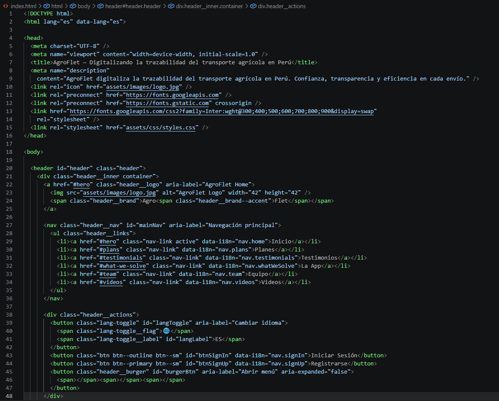
</p>

---

**CSS**

Se utiliza CSS3 puro para controlar la presentación visual, bajo un enfoque modular y responsivo (Mobile-First).

*Convenciones de formato y arquitectura:*

* **Indentación:** 2 espacios por nivel.
* **Sintaxis:** espacio antes de la llave de apertura `{`, llave de cierre `}` en una línea propia y cada declaración terminada en punto y coma `;`.
* **Nomenclatura BEM:** clases escritas como bloque, elemento y modificador (`.plan-card`, `.plan-card__title`, `.plan-card--featured`; `.header`, `.header__nav`, `.header__logo`).
* **Design Tokens:** las variables globales de marca se centralizan en `:root` mediante Custom Properties.
* **Orden de propiedades:** posicionamiento, modelo de caja, tipografía, aspecto visual y animaciones.
* **Especificidad:** se evita anidar selectores más de tres niveles y se restringe el uso de `!important`.
* **Responsive:** media queries incrementales con puntos de corte en `768px` y `1024px`, más ajustes específicos en `max-width: 767px` y `480px`.
* **Accesibilidad:** se respeta la preferencia del sistema mediante `@media (prefers-reduced-motion: reduce)`.

Ejemplo aplicado en el proyecto:

```css
:root {
  /* Brand Colors */
  --green:        #27AE60;
  --navy:         #0B3B60;
  --orange:       #F39C12;
  --font-family:  'Inter', -apple-system, BlinkMacSystemFont, 'Segoe UI', sans-serif;
}

.plan-card {}
.plan-card__title {}
.plan-card--featured {}
```

<p align="center">
  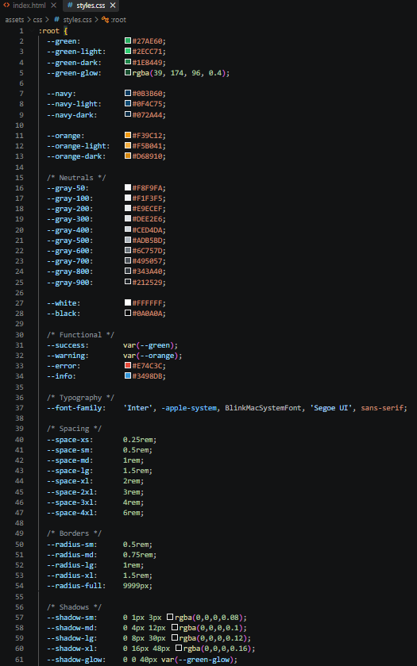
</p>

---

**JavaScript**

Se aplica JavaScript moderno (ECMAScript ES6+) para la interactividad del lado del cliente, sin frameworks ni dependencias externas.

*Convenciones de formato y nomenclatura:*

* **Indentación:** 2 espacios.
* **Modo estricto:** el código se ejecuta dentro de `'use strict';` y se inicializa con `document.addEventListener('DOMContentLoaded', ...)`.
* **Nomenclatura:** `camelCase` para variables y funciones (`setLanguage`, `openAuthModal`, `saveUserSession`, `clearUserSession`); `PascalCase` para clases y componentes; `UPPER_SNAKE_CASE` para constantes globales.
* **Declaración de variables:** `const` por defecto, `let` únicamente para variables reasignables; se prohíbe `var`.
* **Igualdad estricta:** uso obligatorio de `===` y `!==`.
* **Manejo de eventos:** exclusivamente mediante `addEventListener`, evitando atributos de evento en el HTML.
* **Organización:** el archivo se estructura en bloques lógicos numerados y comentados (internacionalización, scroll del header, menú móvil, partículas del hero, contadores, carrusel de testimonios, modales, validaciones y sesión).
* **APIs del navegador:** uso de `IntersectionObserver` para animaciones al hacer scroll y de `localStorage` para persistir preferencias de idioma y la sesión demostrativa.

Ejemplos de funciones implementadas:

```javascript
setLanguage(lang);
openAuthModal(mode, preselectedPlan);
closeAuthModal();
saveUserSession(userData);
clearUserSession();
validateEmail(email);
getPasswordStrength(password);
```

<p align="center">
  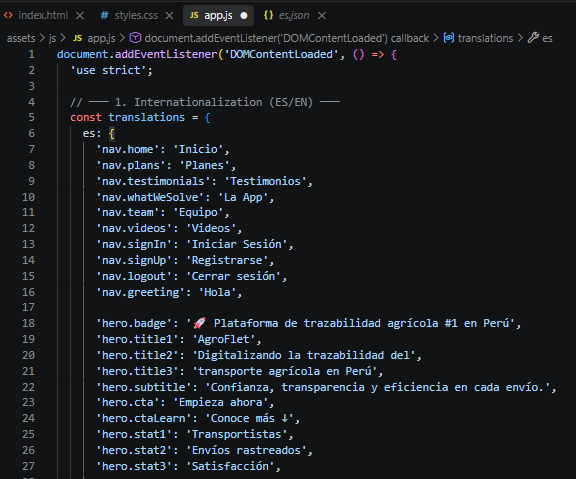
</p>

---

**C# (.NET Core)**

Estas convenciones se aplicarán durante la implementación del RESTful API en los siguientes Sprints, siguiendo las guías oficiales de Microsoft.

*Convenciones de formato y nomenclatura:*

* **Indentación:** 4 espacios.
* **Llaves:** estilo Allman (cada llave en su propia línea).
* **Nomenclatura:** `PascalCase` para clases, métodos y propiedades públicas (`ShipmentsController`, `GetActiveShipments`); prefijo `I` para interfaces (`IShipmentRepository`); `camelCase` para parámetros y variables locales; guion bajo inicial para campos privados (`_dbContext`).
* **Longitud de línea:** máximo 120 caracteres.
* **Inyección de dependencias:** servicios y repositorios inyectados por constructor, evitando instanciaciones directas de lógica de negocio.
* **Controladores ligeros:** la lógica de negocio se delega a la capa de Services.
* **Asincronismo:** los métodos de acceso a datos o I/O son asíncronos y llevan el sufijo `Async` (`GetShipmentByIdAsync`).
* **LINQ:** uso de métodos de extensión para manipular colecciones de forma declarativa.

> Durante el Sprint 1 no se ha implementado código C#, por lo que esta sección constituye la definición normativa que regirá el desarrollo del RESTful API en los Sprints posteriores.

---

### 5.1.4. Software Deployment Configuration

En esta sección se detalla el proceso de configuración y despliegue definido para los productos que componen la solución de AgroFlet.

**1. Landing Page (GitHub Pages)**

* **Plataforma de hosting:** GitHub Pages.
* **Origen del despliegue:** contenido estático de la rama `main` del repositorio de la Landing Page, directorio raíz (`/root`).
* **Archivo de compatibilidad:** `.nojekyll` en la raíz del proyecto, que evita el procesamiento del sitio por Jekyll y garantiza la carga correcta de `assets/`.

*Procedimiento de despliegue aplicado:*

1. Integrar los cambios aprobados de las ramas `feature/*` hacia `develop` mediante Pull Requests con revisión cruzada.
2. Crear la rama `release/v1.0.0` a partir de `develop`.
3. Validar localmente la versión mediante Live Server y Chrome DevTools (desktop y responsive).
4. Integrar la rama de release en `main`.
5. Crear el tag correspondiente según Semantic Versioning (`v1.0.0`).
6. Ingresar a `Settings > Pages` en el repositorio de GitHub.
7. Seleccionar la opción `Deploy from a branch`.
8. Seleccionar la rama `main`.
9. Seleccionar la carpeta `/root` como directorio de origen.
10. Guardar la configuración y esperar la ejecución del workflow de publicación.
11. Validar la URL pública generada, verificando la carga de estilos, scripts, imágenes, el cambio de idioma y el enlace a `docs/Terms-and-conditions.html`.

* **Repositorio:** `[https://github.com/AGROFLET/Agroflet-landing-page]`
* **Versión desplegada:** `v1.0.0`
* **URL de producción:** `[https://agroflet.github.io/Agroflet-landing-page/]`

**Evidencia de la configuración:**

<p align="center">
   Pages" width="700">
</p>

<p align="center">
  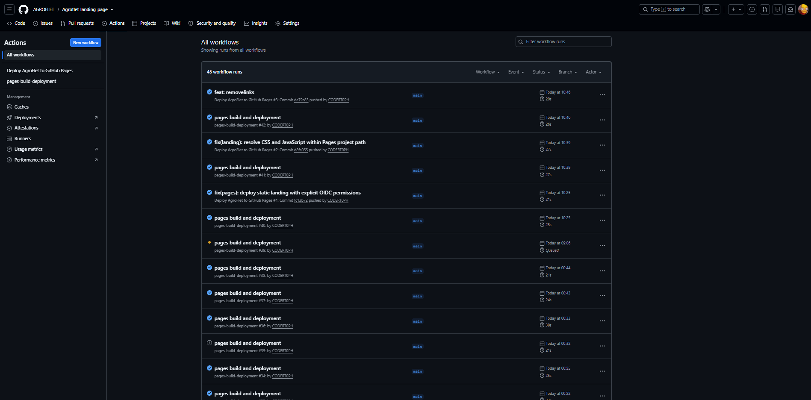
</p>

**2. Frontend Web Application — configuración y despliegue acreditados en TB1**

* **Tecnología:** Vue 3, Vite y PrimeVue; generación de artefactos estáticos mediante `npm ci` y `npm run build`.
* **Proveedor principal:** Vercel, configurado por `vercel.json` con `framework: vite`, `buildCommand: npm run build`, `outputDirectory: dist` y una función `api/index.js` que sirve el servicio simulado.
* **Publicación complementaria:** GitHub Pages con el workflow `.github/workflows/deploy-github-pages.yml`, que compila la aplicación con el `base` correspondiente al repositorio y publica el contenido de `dist/`.
* **Parámetro de API:** `VITE_AGROFLET_PLATFORM_API_URL`. El archivo `.env.production` utiliza `/api/v1` para la publicación en Vercel; el workflow de Pages configura por defecto `https://agroflet-frontend-application.vercel.app/api/v1`. Este destino **corresponde a la Fake API**, no al futuro backend.
* **Direcciones de consulta:** [Vercel](https://agroflet-frontend-application.vercel.app/) y [GitHub Pages](https://agroflet.github.io/Agroflet-frontend-application/). La evidencia de publicaciones, workflows y artefactos se desarrolla en la sección 5.2.2.7.
* **Estado al cierre de TB1:** frontend publicado en los dos proveedores; integración del backend definitivo **no acreditada**. No debe conservarse el estado genérico «pendiente de implementación» para un frontend cuyo despliegue sí está documentado.

**3. Web Services (RESTful API) — diseño de despliegue para AV2**

* **Stack de destino:** ASP.NET Core, C#, Entity Framework Core y MySQL, diferenciado de la Fake API de `json-server` usada en TB1.
* **Proveedor propuesto:** Azure App Service para el servicio .NET y Azure Database for MySQL – Flexible Server para los datos. Se propone esta combinación por la compatibilidad del stack, la administración del runtime, la integración con GitHub y la posibilidad de almacenar la configuración sensible fuera del repositorio. La selección exige revisión de presupuesto y aprobación del equipo; no se presenta como un despliegue ya realizado.
* **Flujo de publicación previsto:** integración de Pull Requests revisados en `develop`, validación de pruebas, compilación con `dotnet publish -c Release`, publicación del artefacto mediante un workflow autenticado, configuración de `ConnectionStrings__DefaultConnection` y opciones de autenticación mediante parámetros protegidos, aplicación controlada de migraciones de Entity Framework Core y prueba de comunicación con MySQL.
* **Pruebas de aceptación para AV2:** (1) endpoint de salud accesible por HTTPS; (2) documentación OpenAPI/Swagger del backend real; (3) al menos un escenario de creación, lectura y actualización persistente en MySQL; (4) validación de autenticación y autorización cuando corresponda; (5) consumo del servicio por la Web Application publicada; (6) capturas del proveedor, ejecución de CI/CD y pruebas HTTP reproducibles.
* **Estado verificable:** la documentación de TB1 acredita el **servicio simulado** y el despliegue del frontend, **no** una aplicación ASP.NET Core productiva. La verificación de estos requisitos queda expresamente como trabajo de AV2 y no como resultado obtenido.

**4. Control de calidad de los artefactos de despliegue**

La retroalimentación de TB1 identificó dos puntos diferentes: la descripción genérica del hosting de C# y una insignia de licencia visible en las capturas de la aplicación. La primera se atiende documentalmente con la alternativa y criterios técnicos anteriores. Para la segunda, el frontend declara `VITE_PRIME_UI_LICENSE_KEY` sin valor en `.env.production`; además, el workflow de Pages admite la variable de repositorio `PRIME_UI_LICENSE_KEY`. Antes de obtener las capturas de AV2, el equipo debe **regularizar y configurar una licencia válida**, confirmar el comportamiento del build desplegado y repetir las capturas de cada flujo. No se considera una corrección suficiente ocultar el indicador con CSS sin resolver primero el estado de licencia.

---

## 5.2. Landing Page, Services & Applications Implementation

### 5.2.1. Sprint 1

Durante el Sprint 1 el equipo se concentró en la implementación y despliegue de la primera versión funcional y responsive de la Landing Page de AgroFlet, así como en la elaboración de la documentación técnica del repositorio.

#### 5.2.1.1. Sprint Planning 1

| Sprint # | Sprint 1 |
| :--- | :--- |
| **Sprint Planning Background** | |
| Date | 08/09/2026 |
| Time | 8:00 PM |
| Location | Google Meet (reunión virtual) |
| Prepared By | Alca Morán, César Alejandro |
| Attendees (to planning meeting) | Alca Morán, César Alejandro<br>Centeno León, Adriano Samir<br>Rivas Méndez, Bernie Aarón<br>Rivas Castillo, Christoper Steven<br>Tello Lima, Jose Alejandro |
| **Sprint 1 Review Summary** | Durante este primer ciclo el equipo consolidó los artefactos de UX definidos en los capítulos anteriores (User Personas, Journey Maps, Arquitectura de la Información, wireframes y mockups) y los tradujo en una implementación web funcional. Se desarrolló y desplegó la primera versión de la Landing Page de AgroFlet, la cual comunica la propuesta de valor orientada a la trazabilidad del transporte agrícola, presenta las funcionalidades proyectadas de la plataforma, los planes de suscripción, los testimonios de los segmentos objetivo, el equipo fundador y el contenido institucional. Se incorporaron navegación responsive, internacionalización español/inglés, carrusel interactivo de testimonios y modales demostrativos de registro e inicio de sesión. |
| **Sprint 1 Retrospective Summary** | El equipo evaluó positivamente la distribución del trabajo mediante ramas `feature/*`, que permitió desarrollar secciones de forma aislada y redujo los conflictos de integración sobre `index.html` y `styles.css`. Se identificó como principal aprendizaje la necesidad de mantener coherencia entre las funcionalidades descritas en el Project Report y aquellas efectivamente implementadas en el producto: la User Story UH28 (formulario de contacto) fue reprogramada para el Sprint 2 al no haberse implementado un `<form>` de contacto en esta versión, manteniéndose únicamente los canales de contacto en el footer. Como oportunidad de mejora se acordó unificar la carga de los diccionarios de internacionalización desde `assets/i18n/` y afinar la estimación de los puntos de historia. |
| **Sprint Goal & User Stories** | |
| **Sprint 1 Goal** | *Our focus is on* publicar la primera versión funcional y responsive de la Landing Page de AgroFlet, que comunica la propuesta de valor del producto, sus funcionalidades proyectadas, los planes de suscripción, el equipo y el contenido institucional, con navegación responsive e internacionalización español/inglés.<br>*We believe it delivers* a los productores agrícolas, transportistas fletistas y compradores mayoristas una comprensión clara y accesible de la solución y del plan de suscripción que les corresponde, sin necesidad de contacto previo con el equipo comercial.<br>*This will be confirmed when* un visitante puede, desde la URL pública de producción y en cualquiera de los dos idiomas, recorrer las secciones mediante el menú, comparar los tres planes y llegar al llamado a la acción de su segmento en no más de tres interacciones, tanto en navegador de escritorio como en dispositivo móvil. |
| **Sprint 1 Velocity** | 24 |
| **Sum of Story Points** | 24 |

**Nota:** Cuadro resumen que detalla la planificación, las metas establecidas, los resultados obtenidos y las métricas de esfuerzo correspondientes al Sprint 1 de AgroFlet.

#### 5.2.1.2. Aspect Leaders and Collaborators

| Team Member | GitHub Username | Landing Page (código) | Diseño UI/UX | Documentación | Deployment |
| :--- | :--- | :--- | :--- | :--- | :--- |
| Alca Morán, César Alejandro | `almocesar` | Líder | Colaborador | Colaborador | Colaborador |
| Centeno León, Adriano Samir | `Adri11-dk` | Colaborador | Colaborador | Líder | Colaborador |
| Rivas Méndez, Bernie Aarón | `ARivas3008` | Colaborador | Líder | Colaborador | Colaborador |
| Rivas Castillo, Christoper Steven | `C0DERTOPH` | Colaborador | Colaborador | Colaborador | Colaborador |
| Tello Lima, Jose Alejandro | `j4ndrow` | Colaborador | Colaborador | Colaborador | Líder |

**Distribución por aspecto técnico del Sprint 1:**

| Aspecto | Líder | Colaboradores |
| :--- | :--- | :--- |
| Landing Page UX/UI | Rivas Méndez, Bernie Aarón | Tello Lima, Jose Alejandro / Alca Morán, César Alejandro |
| HTML Structure & Semántica | Alca Morán, César Alejandro | Centeno León, Adriano Samir / Rivas Castillo, Christoper Steven |
| CSS & Responsive Design | Rivas Méndez, Bernie Aarón | Alca Morán, César Alejandro / Rivas Castillo, Christoper Steven |
| JavaScript Interactions | Rivas Castillo, Christoper Steven | Alca Morán, César Alejandro / Centeno León, Adriano Samir |
| Internationalization (i18n) | Centeno León, Adriano Samir | Rivas Castillo, Christoper Steven / Tello Lima, Jose Alejandro |
| Documentation (README & Report) | Centeno León, Adriano Samir | Tello Lima, Jose Alejandro / Rivas Méndez, Bernie Aarón |
| Deployment (GitHub Pages) | Tello Lima, Jose Alejandro | Alca Morán, César Alejandro / Centeno León, Adriano Samir |

**Nota:** Distribución de responsabilidades durante el Sprint 1, indicando el liderazgo y la colaboración en las principales áreas de trabajo. Los usuarios de GitHub consignados deben coincidir con las cuentas registradas como Contributors del repositorio.

#### 5.2.1.3. Sprint Backlog 1

| User Story Id | User Story Title | Work Item / Task Id | Work Item / Task Title | Description | Estimation (h) | Assigned To | Status |
| :--- | :--- | :--- | :--- | :--- | :---: | :--- | :---: |
| UH24 | Visualización de la propuesta de valor en el landing page | T01 | Estructuración base en HTML5 e implementación del Hero | Creación del esqueleto semántico del documento (`header`, `main`, `section`, `footer`) e implementación de la sección principal con el nombre de la plataforma, el titular de propuesta de valor, contadores estadísticos animados y llamados a la acción diferenciados. | 4 | Alca Morán, César Alejandro | Finalizada |
| UH25 | Consulta de funcionalidades principales desde el landing page | T02 | Implementación de la sección informativa de funcionalidades | Maquetación de la grilla de tarjetas de la sección "La App", con seis funcionalidades clave, ícono SVG representativo y descripción breve para cada una. | 3 | Rivas Castillo, Christoper Steven | Finalizada |
| UH26 | Consulta de planes y precios en el landing page | T03 | Maquetación de la sección de planes de suscripción | Implementación de las tarjetas de los planes Básico, Estándar y Profesional, con unidades incluidas, funcionalidades habilitadas, cinta de plan destacado y botón de llamado a la acción por segmento. | 3 | Rivas Méndez, Bernie Aarón | Finalizada |
| UH27 | Consulta de testimonios de usuarios en el landing page | T04 | Desarrollo del carrusel interactivo de testimonios | Implementación del carrusel con cinco testimonios (nombre, rol y procedencia), navegación circular, indicadores, rotación automática con pausa en interacción y soporte de gestos táctiles y arrastre con mouse. | 4 | Rivas Castillo, Christoper Steven | Finalizada |
| UH29 | Navegación fluida entre secciones del landing page | T05 | Implementación de navegación responsive y scroll suave | Desarrollo del header fijo con cambio de estado al hacer scroll, resaltado del ítem activo, menú hamburguesa para dispositivos móviles y desplazamiento suave mediante anchors sin recargar la página. | 3 | Alca Morán, César Alejandro | Finalizada |
| UH30 | Visualización del landing page en múltiples idiomas | T06 | Implementación del sistema de internacionalización ES/EN | Integración de los diccionarios de traducción y del selector de idioma del encabezado, actualización dinámica de todos los nodos marcados con `data-i18n` (incluidos placeholders y mensajes de validación) y persistencia de la preferencia en `localStorage`. | 4 | Centeno León, Adriano Samir | Finalizada |
| UH24 | Visualización de la propuesta de valor en el landing page | T07 | Configuración del diseño responsive (Mobile-First) | Definición de los design tokens en `:root` y de las media queries en 480 px, 768 px y 1024 px para garantizar la correcta visualización en smartphones, tablets y escritorio. | 3 | Rivas Méndez, Bernie Aarón | Finalizada |
| UH24 | Visualización de la propuesta de valor en el landing page | T08 | Desarrollo de la sección del equipo y sección de videos | Implementación de las tarjetas de perfil de los cinco integrantes del equipo fundador y de las tarjetas de acceso a los videos institucionales mediante modal con reproducción embebida. | 2 | Tello Lima, Jose Alejandro | Finalizada |
| UH24 | Visualización de la propuesta de valor en el landing page | T09 | Implementación del footer institucional y documento legal | Desarrollo del pie de página con enlaces de navegación, canales de contacto y accesos legales, e implementación del documento de Términos y Condiciones en `docs/Terms-and-conditions.html`. | 2 | Centeno León, Adriano Samir | Finalizada |
| UH24 | Visualización de la propuesta de valor en el landing page | T10 | Despliegue de la versión v1.0.0 en GitHub Pages | Configuración del repositorio, creación del archivo `.nojekyll`, habilitación de GitHub Pages desde la rama `main` y validación de la URL pública de producción. | 2 | Tello Lima, Jose Alejandro | Finalizada |
| UH28 | Envío de mensaje de contacto desde el landing page | T11 | Implementación del formulario de contacto | Desarrollo de un formulario de contacto con validación de campos obligatorios y confirmación de envío. | 3 | Rivas Méndez, Bernie Aarón | Finalizada |

**Nota:** Tabla que vincula las User Stories del EPIC-09 abordadas durante el Sprint 1 con sus respectivas tareas técnicas, el esfuerzo estimado en horas, el responsable asignado y el estado de cada asignación. La tarea T11, asociada a la User Story UH28, se mantiene en estado *In Process* y se reprograma para el Sprint 2, dado que la versión `v1.0.0` de la Landing Page expone los canales de contacto en el footer pero aún no incorpora un formulario de contacto.

#### 5.2.1.4. Development Evidence for Sprint Review

Esta sección expone la evidencia técnica del progreso alcanzado durante el Sprint con relación a los productos definidos en el alcance. Durante el Sprint 1 se implementó la primera versión funcional de la Landing Page de AgroFlet utilizando HTML5, CSS3 y JavaScript (ES6+), sin frameworks ni dependencias externas.

Las principales funcionalidades desarrolladas incluyen:

* navegación responsive con header fijo, resaltado de sección activa y menú hamburguesa;
* sección principal (Hero) con propuesta de valor, contadores estadísticos animados y sistema de partículas optimizado;
* sección de planes de suscripción (Básico, Estándar y Profesional);
* carrusel interactivo de testimonios con soporte táctil, arrastre y rotación automática;
* sección informativa de funcionalidades proyectadas de la plataforma;
* presentación del equipo fundador;
* sección de videos con modal de reproducción embebida y corte automático al cerrar;
* internacionalización español/inglés con persistencia en `localStorage`;
* formularios demostrativos de registro e inicio de sesión con validación en tiempo real e indicador de fortaleza de contraseña;
* modales informativos de Términos de Uso, Política de Privacidad y Preguntas Frecuentes;
* sistema de notificaciones tipo *toast*;
* diseño adaptable para escritorio, tablet y dispositivos móviles.

> La autenticación incluida en esta versión es exclusivamente demostrativa: se ejecuta en el cliente mediante JavaScript y `localStorage`, y no se encuentra integrada con el RESTful API de AgroFlet.

**Registro de commits del Sprint 1:**

| Repository | Branch | Commit Id | Commit Message | Commit Message Body | Commited on (Date) |
| :--- | :--- | :--- | :--- | :--- | :--- |
| agroflet-landing-page | `feature/header-navigation` | `77a83d2` | feat: implement responsive header and navigation | Added fixed header, scroll state, active section tracking and mobile burger menu. | `17/09/2026` |
| agroflet-landing-page | `feature/hero-section` | `690c3cc` | feat: implement hero section with animated counters | Added value proposition hero, animated statistics counters and particle background. | `17/09/2026` |
| agroflet-landing-page | `feature/plans-section` | `3d602c7` | feat: add subscription plans section | Implemented Basic, Standard and Professional plan cards with segmented call to action. | `17/09/2026` |
| agroflet-landing-page | `feature/testimonials-carousel` | `8a42a8c` | feat: add testimonials carousel | Implemented touch and drag enabled carousel with auto rotation and dot indicators. | `17/09/2026` |
| agroflet-landing-page | `feature/solve-section` | `487b350` | feat: implement platform features section | Added responsive grid with six key platform features and SVG icons. | `17/09/2026` |
| agroflet-landing-page | `feature/team-section` | `e1f9f0d` | feat: create team and videos presentation | Added founding team profile cards and institutional video modal. | `17/09/2026` |
| agroflet-landing-page | `feature/auth-modal` | `3b97e89` | feat: implement demo authentication modal | Added sign up and sign in forms with live validation and password strength indicator. | `17/09/2026` |
| agroflet-landing-page | `feature/i18n` | `5f2486c` | feat: implement bilingual landing page | Added ES/EN dictionaries, language toggle and localStorage persistence. | `17/09/2026` |
| agroflet-landing-page | `feature/footer-legal` | `fe83b67` | feat: add footer and terms and conditions page | Implemented institutional footer and legal document under docs directory. | `17/09/2026` |
| agroflet-landing-page | `feature/responsive-layout` | `c4cc20d` | style: improve responsive card layout | Adjusted design tokens and media queries for mobile, tablet and desktop breakpoints. | `18/09/2026` |
| agroflet-landing-page | `develop` | `a7677c2` | docs: update landing page documentation | Updated README with project structure, features and local execution instructions. | `18/09/2026` |
| agroflet-landing-page | `main` | `fc13b72` | chore: prepare release v1.0.0 and trigger deployment | Merged release branch and triggered GitHub Pages deployment. | `18/09/2026` |


**Evidencia del código HTML:**

<p align="center">
  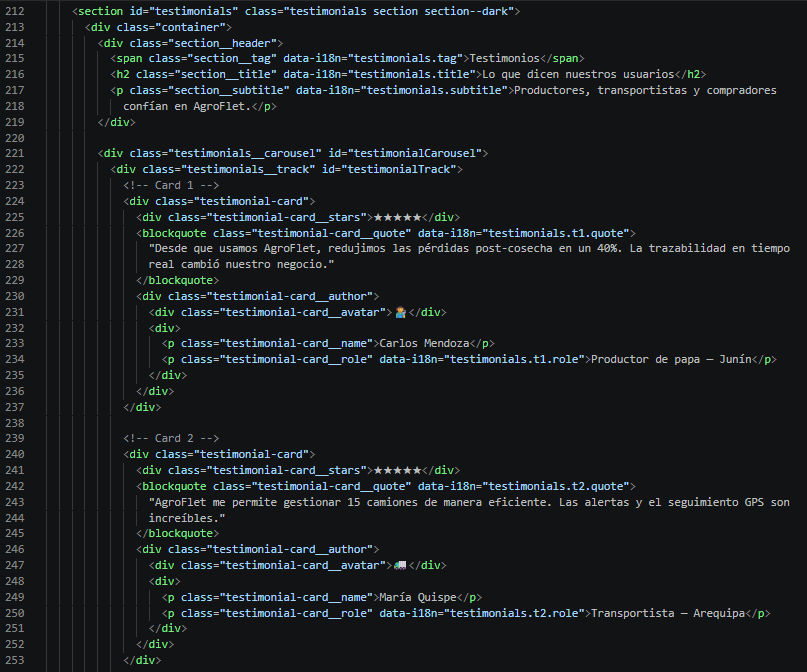
</p>

**Evidencia de los estilos CSS:**

<p align="center">
  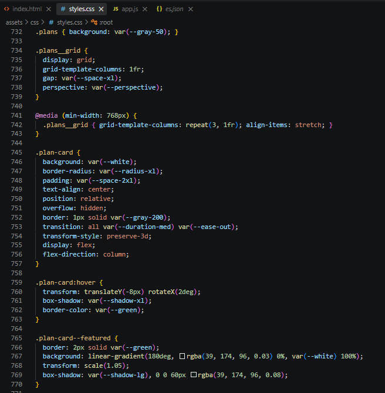
</p>

**Evidencia del código JavaScript:**

<p align="center">
  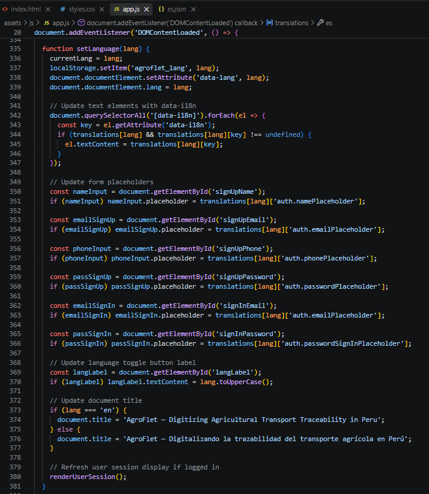
</p>

**Evidencia de los diccionarios de internacionalización:**

<p align="center">
  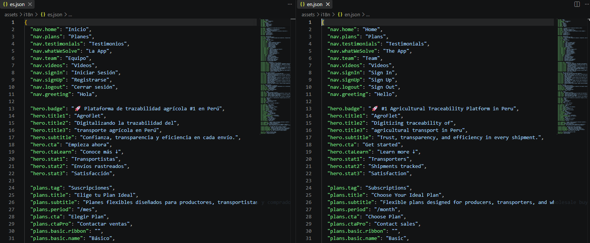
</p>

**Evidencia de commits y Pull Requests en GitHub:**

<p align="center">
  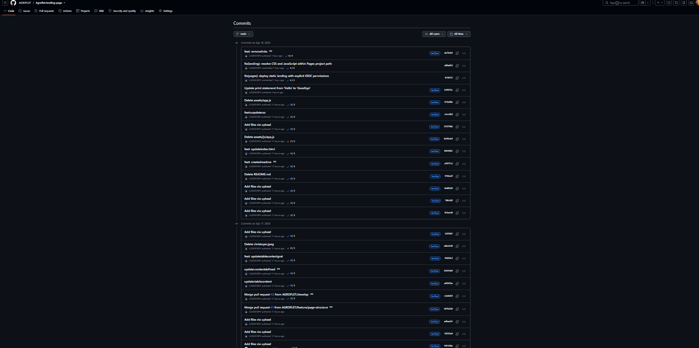
</p>

<p align="center">
  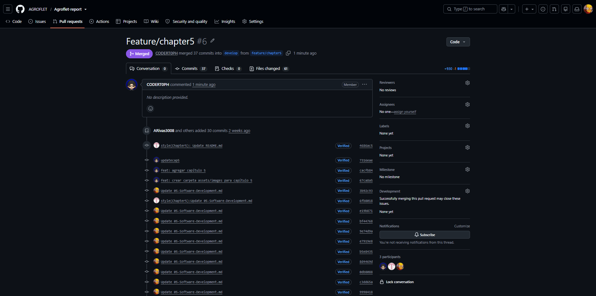
</p>

#### 5.2.1.5. Execution Evidence for Sprint Review

Se verificó la ejecución de la Landing Page de AgroFlet en navegador de escritorio y mediante las herramientas responsive de Google Chrome DevTools, validando los siguientes comportamientos:

* navegación mediante anchors con desplazamiento suave y resaltado de la sección activa;
* apertura y cierre del menú responsive en dispositivos móviles;
* adaptación del contenido en resoluciones de escritorio, tablet y smartphone;
* cambio de idioma español/inglés sin recarga de página y persistencia de la preferencia;
* funcionamiento del carrusel de testimonios mediante botones, indicadores, gestos táctiles y arrastre;
* apertura de los modales de registro, inicio de sesión, video y documentos legales;
* validación en tiempo real de los campos de registro e inicio de sesión demostrativo;
* presentación correcta del contenido institucional y del documento de Términos y Condiciones.

**Evidencia visual:**

**1. Sección principal (Hero) — propuesta de valor**

*Desarrollado por: Alca Morán, César Alejandro*

<p align="center">
  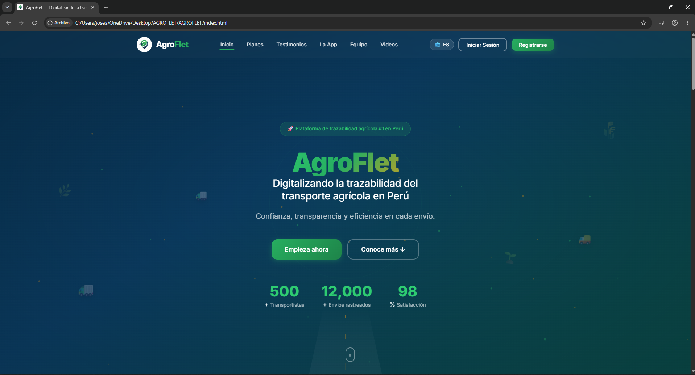
</p>

**2. Planes de suscripción**

*Desarrollado por: Rivas Méndez, Bernie Aarón*

<p align="center">
  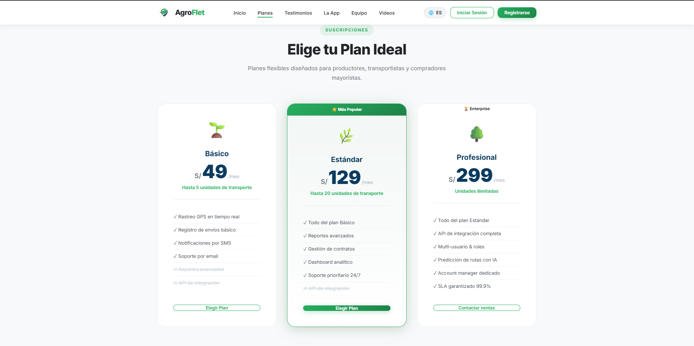
</p>

**3. Testimonios de usuarios**

*Desarrollado por: Rivas Castillo, Christoper Steven*

<p align="center">
  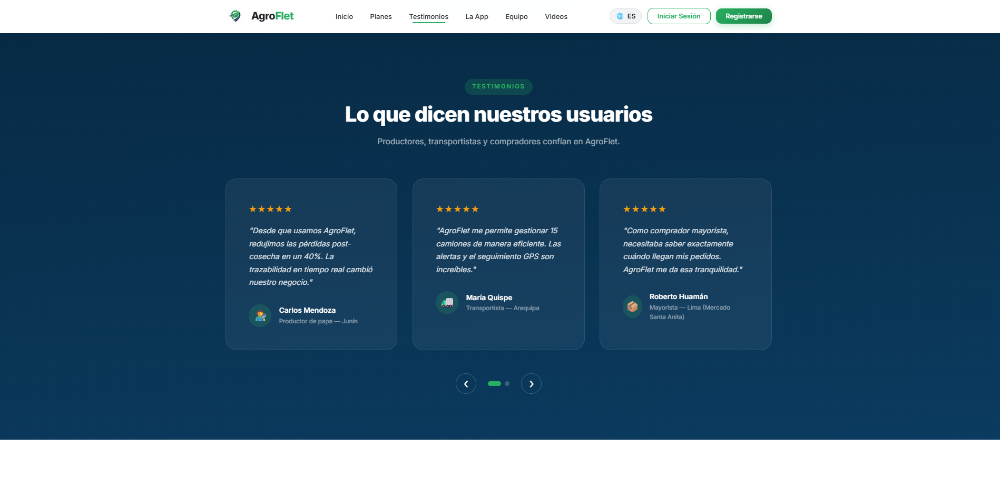
</p>

**4. Funcionalidades de la plataforma (La App)**

*Desarrollado por: Rivas Castillo, Christoper Steven*

<p align="center">
  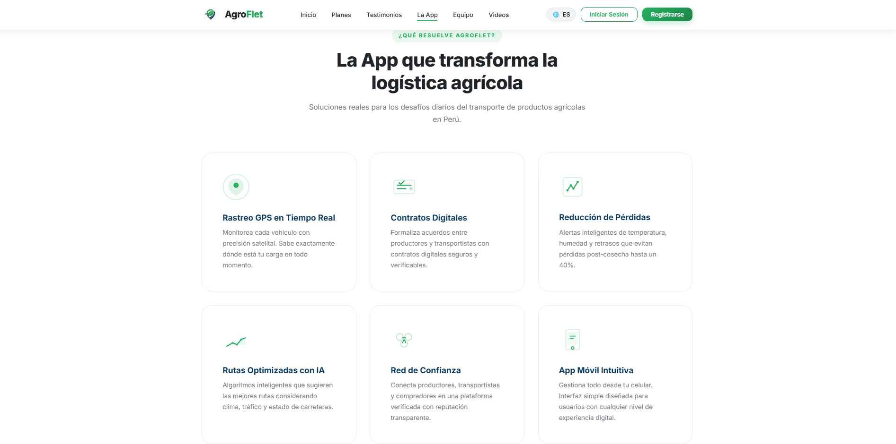
</p>

**5. Equipo y videos institucionales**

*Desarrollado por: Tello Lima, Jose Alejandro*

<p align="center">
  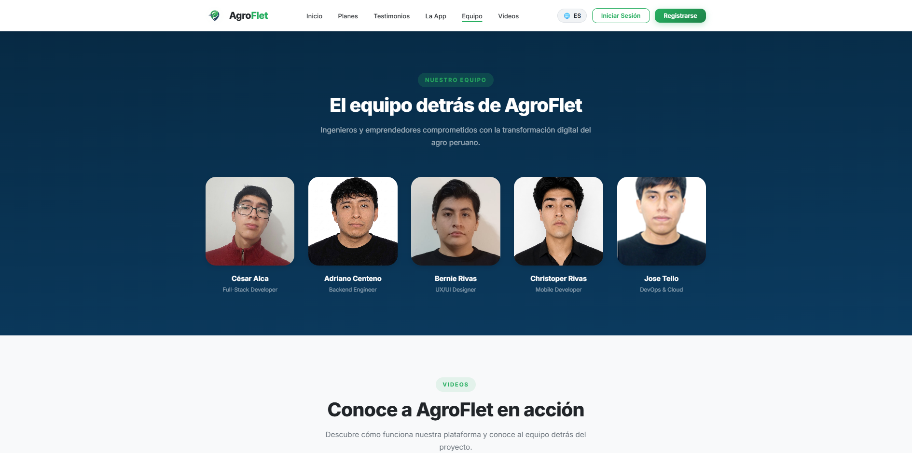
</p>

<p align="center">
  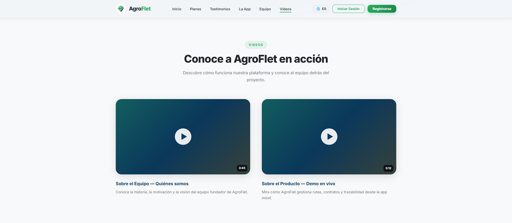
</p>

**6. Footer institucional y Términos y Condiciones**

*Desarrollado por: Centeno León, Adriano Samir*

<p align="center">
  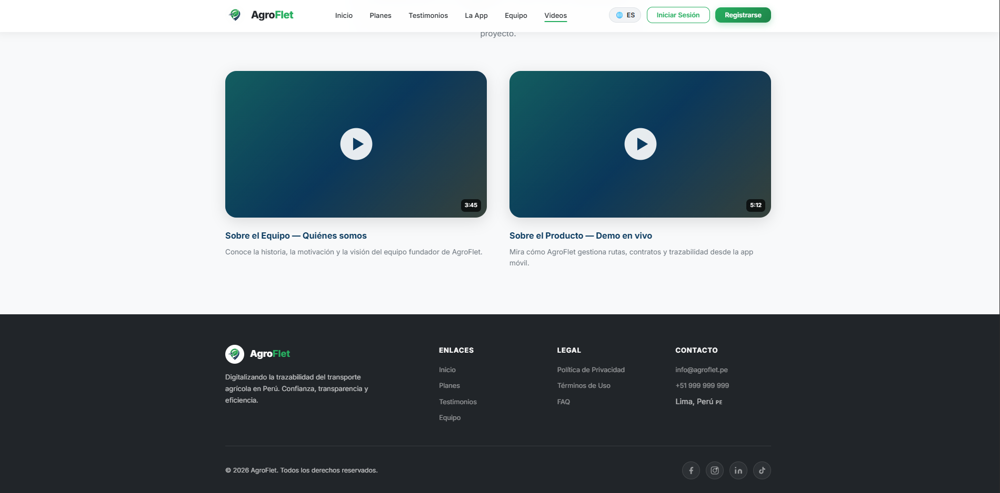
</p>

<p align="center">
  
</p>

**7. Internacionalización (ES / EN)**

*Desarrollado por: Centeno León, Adriano Samir*

<p align="center">
  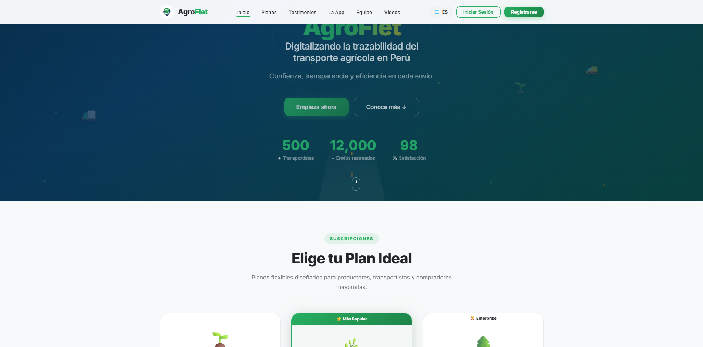
</p>

<p align="center">
  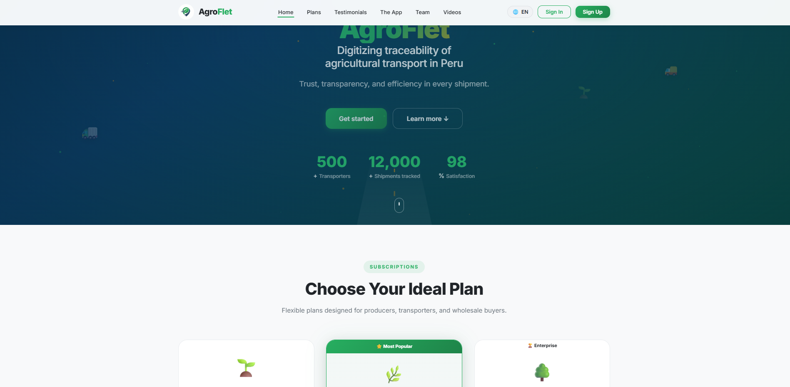
</p>

**8. Modales demostrativos de registro e inicio de sesión**

*Desarrollado por: Alca Morán, César Alejandro*

<p align="center">
  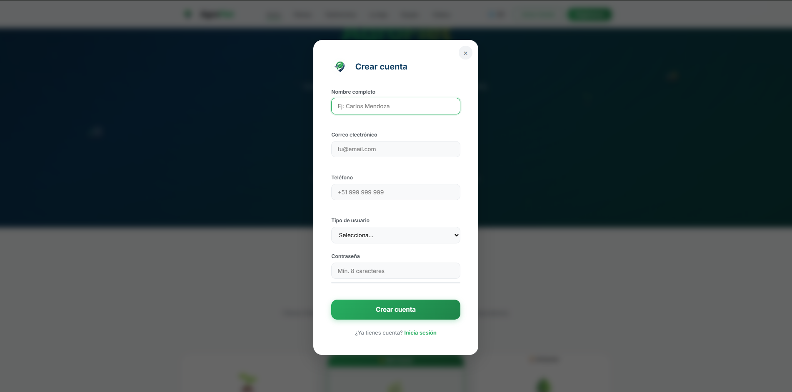
</p>

<p align="center">
  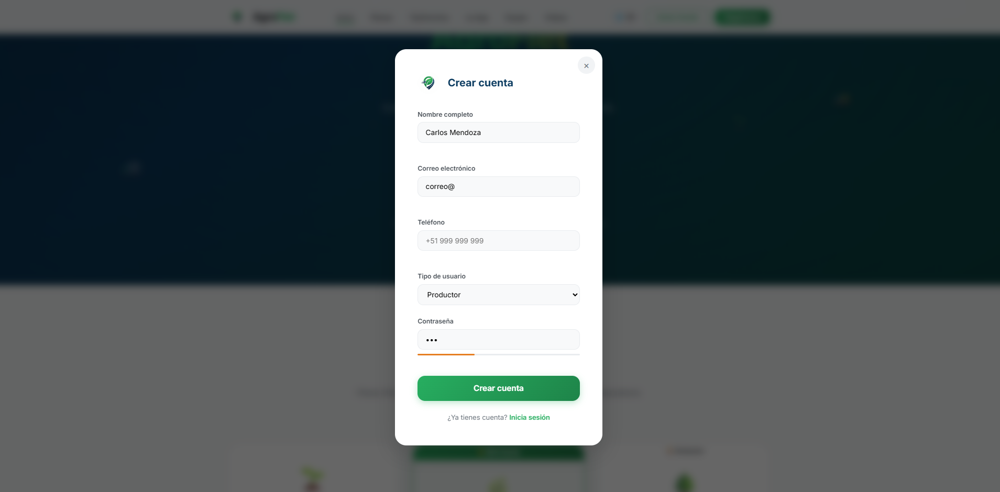
</p>

**9. Vista móvil y validación responsive**

*Desarrollado por: Rivas Méndez, Bernie Aarón*

<p align="center">
  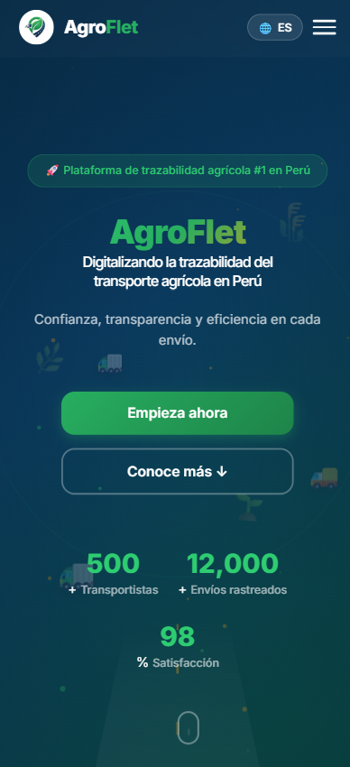
</p>

<p align="center">
  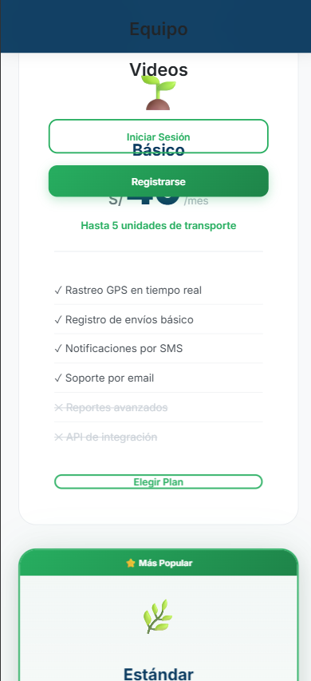
</p>

<p align="center">
  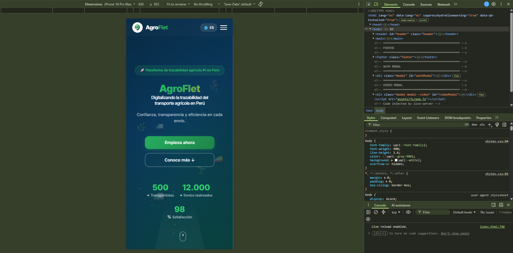
</p>


#### 5.2.1.6. Services Documentation Evidence for Sprint Review

Durante el Sprint 1, la Landing Page de AgroFlet no consume todavía el RESTful API de la plataforma ni servicios externos orientados a los procesos logísticos.

Las funcionalidades interactivas de registro e inicio de sesión presentes en esta versión corresponden a una demostración ejecutada íntegramente en el cliente mediante JavaScript y `localStorage`, tal como se declara en la sección 5.2.1.4. Del mismo modo, las cifras mostradas en los contadores del Hero y los testimonios son contenido estático de presentación.

La integración con los servicios RESTful internos (endpoints de autenticación, gestión de flotas, operaciones de transporte e incidencias especificados como Technical Stories en el Capítulo III) se incorporará en los siguientes Sprints desde la Frontend Web Application desarrollada con Vue.js.

Por lo tanto, en este Sprint no corresponde presentar documentación OpenAPI o Swagger como evidencia de consumo de servicios desde la Landing Page. En las siguientes entregas esta sección se actualizará para incluir:

* la relación completa de los endpoints implementados;
* el verbo HTTP asociado a cada acción (GET, POST, PUT, PATCH, DELETE) y la sintaxis de las llamadas;
* el detalle de los parámetros requeridos y la explicación estructurada de las respuestas;
* capturas de pantalla de la interacción funcional con la API mediante Swagger UI con datos de muestra;
* el enlace al repositorio de Web Services y los identificadores de los commits asociados a la documentación.

#### 5.2.1.7. Software Deployment Evidence for Sprint Review

La versión `v1.0.0` de la Landing Page de AgroFlet fue publicada exitosamente utilizando GitHub Pages. Dado que el alcance de esta iteración se limitó a la presentación web estática, aún no se han configurado entornos de despliegue para la Frontend Web Application ni para los Web Services.

**Actividades de despliegue realizadas:**

**1. Configuración del repositorio de código fuente**

* Se creó un repositorio público dedicado exclusivamente a la Landing Page dentro de la organización del equipo.
* Se estructuró el control de versiones bajo GitFlow para facilitar la publicación desde la rama `main`.
* Enlace del repositorio: `[https://github.com/AGROFLET/Agroflet-landing-page]`

**2. Habilitación y configuración de GitHub Pages**

* Se activó el servicio de alojamiento estático desde `Settings > Pages` del repositorio.
* Se definió la rama `main` y el directorio raíz (`/root`) como origen de los archivos publicados.
* Se incorporó el archivo `.nojekyll` en la raíz del proyecto para evitar el procesamiento por Jekyll y asegurar la carga del directorio `assets/`.

<p align="center">
  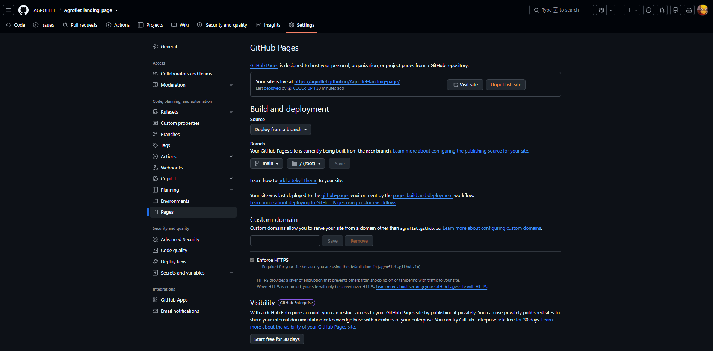 Pages" width="700">
</p>

**3. Publicación automatizada**

* Cada integración aprobada hacia `main` dispara automáticamente el workflow de publicación de GitHub Pages, actualizando el contenido en producción sin intervención manual del equipo.

<p align="center">
  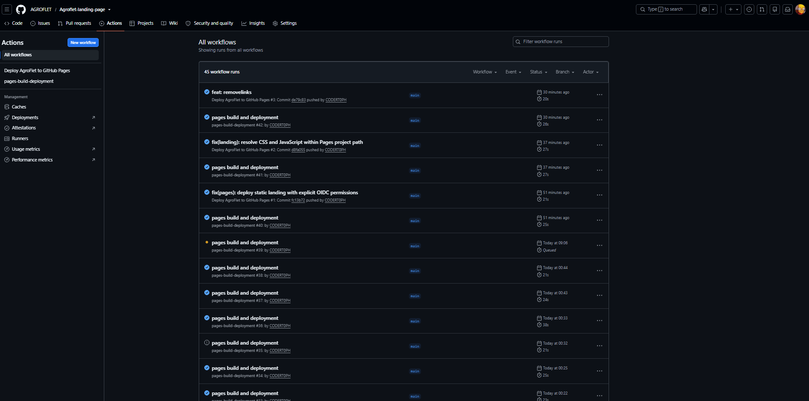
</p>

**4. Verificación y validación en producción**

* Se validó la correcta carga de estilos, scripts e imágenes desde la URL pública.
* Se verificó el funcionamiento del cambio de idioma, del carrusel de testimonios y de los modales en el entorno desplegado.
* Se comprobó el acceso al documento `docs/Terms-and-conditions.html` desde el footer.

* **Versión desplegada:** `v1.0.0`
* **URL de producción:** `[https://agroflet.github.io/Agroflet-landing-page/]`

<p align="center">
  
</p>

#### 5.2.1.8. Team Collaboration Insights during Sprint

Durante el Sprint 1 el equipo distribuyó el desarrollo de la Landing Page en aspectos claramente delimitados: estructura HTML semántica, diseño responsive, componentes visuales, interacciones JavaScript, internacionalización, documentación y despliegue.

**Actividades de implementación desarrolladas:**

* **Planificación visual:** se tomaron como referencia los wireframes y mockups elaborados en Figma durante el Capítulo IV para definir la jerarquía de la información, las secciones y la aplicación de la paleta de marca de AgroFlet.
* **Desarrollo modular:** la maquetación se dividió en componentes independientes (Header, Hero, Plans, Testimonials, Solve, Team, Videos, Footer y Modales), permitiendo que cada integrante trabajara en una rama `feature/*` propia.
* **Integración de funcionalidades:** se aplicaron estilos responsivos mediante CSS Grid, Flexbox y Custom Properties, y se incorporó la lógica de interactividad en JavaScript, incluyendo el sistema de internacionalización español/inglés.
* **Gestión de versiones y despliegue:** se utilizó GitHub como plataforma central, aplicando Pull Requests y revisiones cruzadas antes de integrar los cambios a `develop` y, posteriormente, a `main` para su publicación en GitHub Pages.

La estrategia de ramas permitió reducir los conflictos de integración sobre archivos compartidos como `index.html` y `styles.css`, y mantener trazabilidad sobre las contribuciones individuales. Como principal aprendizaje, el equipo identificó la importancia de mantener coherencia entre las funcionalidades descritas en el Project Report y aquellas efectivamente implementadas en el producto, criterio que motivó la reprogramación de la User Story UH28 al Sprint 2.

**Analíticas de colaboración en GitHub:**

**1. Evidencia de ramas del repositorio**

<p align="center">
  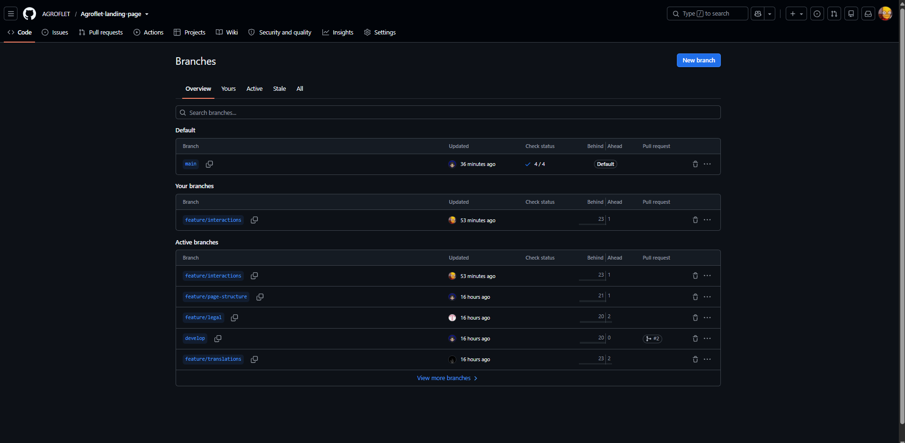
</p>

**2. Historial de commits por integrante**

*Alca Morán, César Alejandro (`CesarAlcaM`)*
<p align="center">
  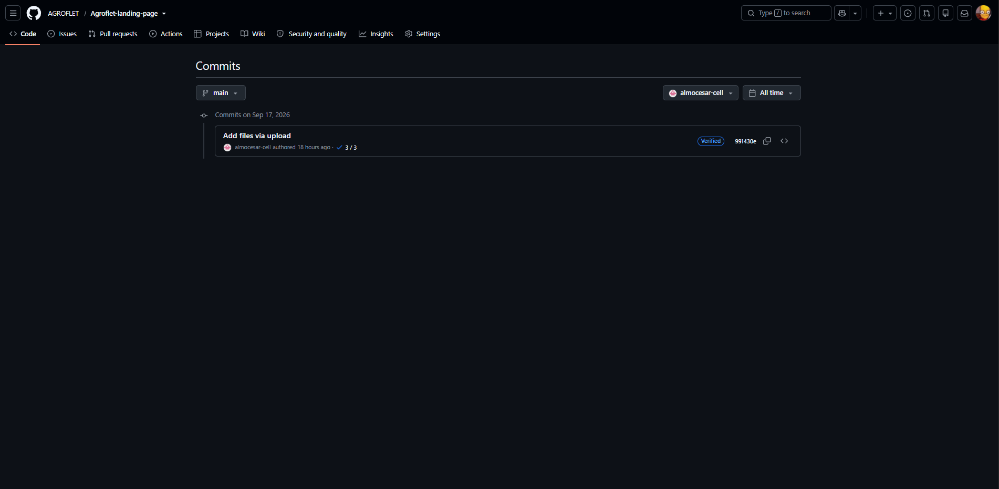
</p>

*Centeno León, Adriano Samir (`AdrianoCenteno`)*
<p align="center">
  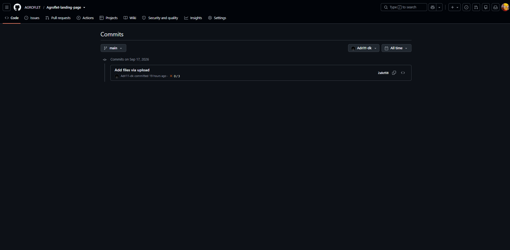
</p>

*Rivas Méndez, Bernie Aarón (`BernieRivasM`)*
<p align="center">
  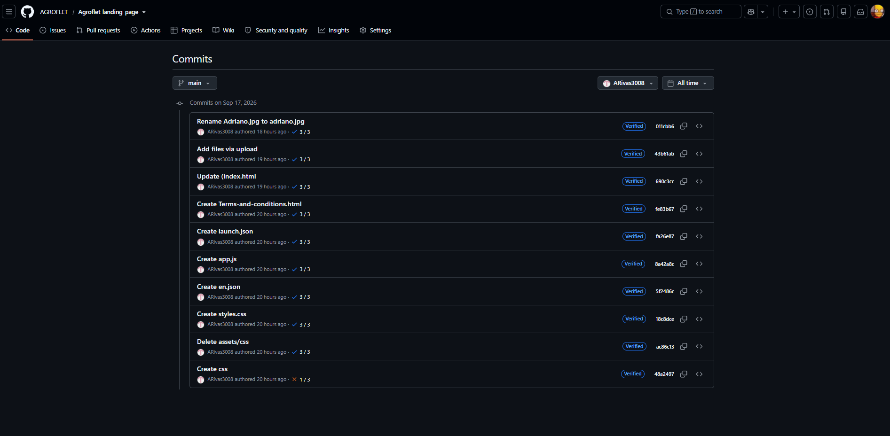
</p>

*Rivas Castillo, Christoper Steven (`ChristoperRivasC`)*
<p align="center">
  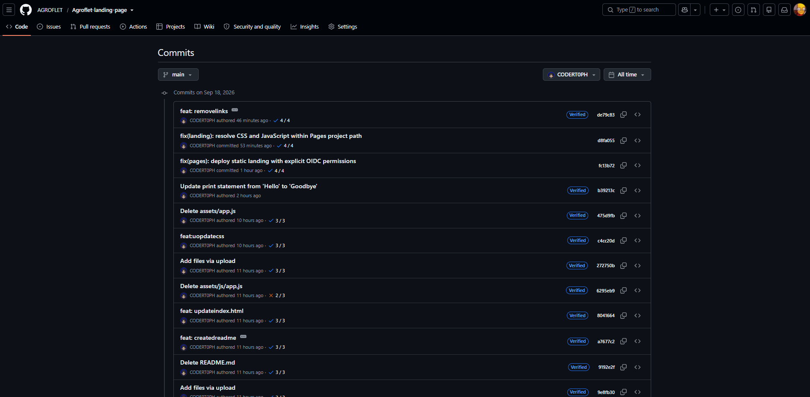
</p>

*Tello Lima, Jose Alejandro (`JoseTelloL`)*
<p align="center">
  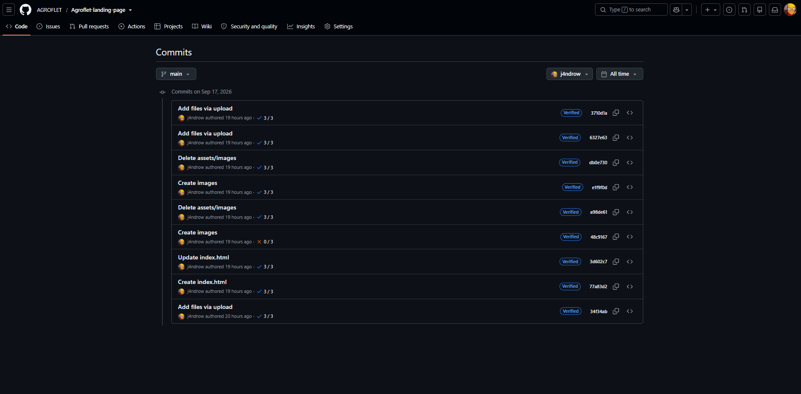
</p>

**3. Colaboradores activos en el repositorio**

*Gráfica de la actividad conjunta del equipo y de la distribución de aportes (adiciones y eliminaciones de código) durante el Sprint.*

<p align="center">
  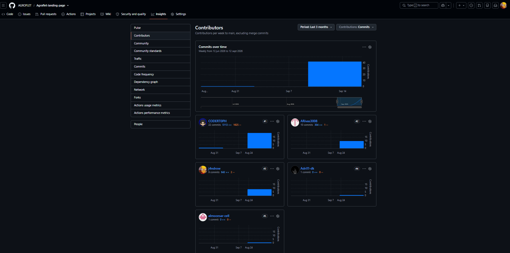 Contributors" width="700">
</p>

**4. Histograma de contribuciones en el tiempo**

*Frecuencia de commits realizados durante el Sprint, evidenciando un esfuerzo sostenido y coordinado hacia la integración final.*

<p align="center">
  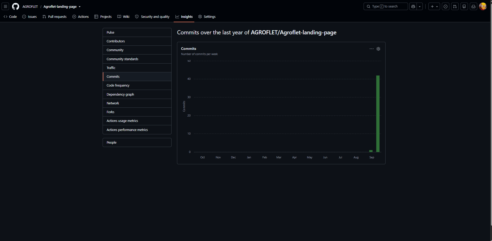 Commits" width="700">
</p>

---

### 5.2.2. Sprint 2

Durante el Sprint 2 se implementó la primera versión de la **Frontend Web Application de AgroFlet (v1.0.0)** para despachadores y compradores mayoristas. La aplicación, desarrollada con **Vue 3, Vite, PrimeVue, Pinia y Vue Router**, consume una **Fake API con json-server** y se publicó en Vercel y GitHub Pages. El alcance se basa en las historias del Capítulo III que no se desarrollaron en el Sprint 1.

#### 5.2.2.1. Sprint Planning 2

| Sprint # | Sprint 2 |
| :--- | :--- |
| **Sprint Planning Background** | |
| Date | 24/09/2026  |
| Time | 8:00 PM |
| Location | Google Meet |
| Prepared By | Alca Morán, César Alejandro |
| Attendees (to planning meeting) | Alca Morán, César Alejandro<br>Centeno León, Adriano Samir<br>Rivas Méndez, Bernie Aarón<br>Rivas Castillo, Christoper Steven<br>Tello Lima, Jose Alejandro |
| **Sprint 1 Review Summary** | Se desplegó la Landing Page v1.0.0, con información del producto, planes, testimonios, navegación responsive e idiomas ES/EN. La historia de contacto **US28** quedó pendiente. |
| **Sprint 1 Retrospective Summary** | Se mantuvo el trabajo paralelo con GitFlow y se priorizó la integración temprana entre vistas, servicios y componentes compartidos. |
| **Sprint Goal & User Stories** | |
| **Sprint 2 Goal** | *Our focus is on* publicar una aplicación que permita gestionar flotas y envíos, reportar posiciones e incidencias y consultar alertas por rol.<br>*We believe it delivers* mayor visibilidad y coordinación a despachadores y compradores.<br>*This will be confirmed when* se pueda registrar, iniciar y cerrar una operación de demostración, y el comprador asociado consulte su seguimiento desde la aplicación publicada. |
| **Sprint 2 Velocity** | **84 Story Points registrados como completados** al cierre documental de TB1: 81 SP de las 27 historias de la Web Application y 3 SP de US28 (Contacto), recuperada del Sprint 1. |
| **Sum of Story Points** | **84 SP comprometidos / 84 SP marcados como finalizados (100 % del alcance declarado)**. El total procede de los valores del Product Backlog (Capítulo III) y los estados de las 28 tareas principales del Sprint Backlog 2 (sección 5.2.2.3). |

**Nota de trazabilidad:** El Product Backlog del Capítulo III usa identificadores **US** y el Sprint 1 utiliza **UH** para algunas historias del Landing Page; aquí se conservan los **US** originales. La velocidad de **84 SP** representa el esfuerzo **declarado como completado** en el backlog del Sprint 2, no una medición independiente de calidad ni evidencia de que ya se haya desplegado el backend en ASP.NET Core. La verificación funcional de la Fake API y del frontend se documenta en las secciones 5.2.2.5 a 5.2.2.7.

#### 5.2.2.2. Aspect Leaders and Collaborators

A continuación, se presenta la distribución de responsabilidades para el desarrollo del Sprint 2 de AgroFlet. En este cuadro se detallan los módulos técnicos o aspectos liderados por cada integrante, así como sus áreas de colaboración cruzada, garantizando el cumplimiento de todos los objetivos planificados bajo un enfoque de trabajo colaborativo.

| Team Member | GitHub Username* | Aspecto liderado | Colaboración |
| :--- | :--- | :--- | :--- |
| Tello Lima, Jose Alejandro | `j4ndrow` | Fake API y gestión de flotas | Integración de servicios |
| Centeno León, Adriano Samir | `Adri11-dk` | Internacionalización, perfil y documentación | Revisión funcional |
| Rivas Castillo, Christoper Steven | `CODERT0PH` | Configuración, IAM, incidencias y despliegue | Integración de la aplicación |
| Rivas Méndez, Bernie Aarón | `ARivas3008` | Interfaz compartida y seguimiento cartográfico | Diseño responsive |
| Alca Morán, César Alejandro | `almocesar-cell` | Operaciones y gestión de envíos | Integración de vistas |

*Los nombres de usuario se toman de la documentación del repositorio y deben contrastarse con **Insights > Contributors** antes de la entrega.*

**L:** líder del aspecto. **C:** colaborador. **—:** sin participación específica documentada en ese aspecto. La validación documental está asignada a Adriano; la gestión de flotas a Jose; las operaciones y envíos a César. Los accesos, incidencias y la preparación del despliegue registran commits de Christoper, y el seguimiento cartográfico registra commits de Bernie.

**Distribución por ramas:**

| Feature Branch | Responsable | Desarrollo |
| :--- | :--- | :--- |
| `feature/project-setup` | Christoper Rivas | Configuración de Vue, Vite y estructura por capas |
| `feature/fake-api-and-fleet` | Jose Tello | Fake API, vehículos y conductores |
| `feature/i18n-profile-and-docs` | Adriano Centeno | Idiomas, perfil y documentación |
| `feature/iam-incidents-and-deployment` | Christoper Rivas | Autenticación, incidencias y despliegue |
| `feature/shared-ui-and-tracking` | Bernie Rivas | Componentes compartidos, mapas y posiciones |
| `feature/shipment-operations` | César Alca | Registro, consulta y ciclo de vida de operaciones |


#### 5.2.2.3. Sprint Backlog 2

El Backlog incorpora las **27 User Stories de la aplicación web no trabajadas en el Sprint 1** (US01–US23, US31–US34). La historia **US28**, pendiente del Landing Page, se registra por separado. Los títulos provienen del Capítulo III; las tareas se sintetizan a partir de la implementación documentada en GitHub. Se usa una tarea resumida por historia para facilitar la lectura.

| User Story Id | User Story Title | Work Item / Task Id | Work Item / Task Title | Description | Estimation (h) | Assigned To | Status |
| :--- | :--- | :--- | :--- | :--- | ---: | :--- | :---: |
| US01 | Registro de cuenta | T01 | Registro de usuarios | Crear formulario por rol y validar campos y correo único. | 5 | Christoper Rivas | Finalizada |
| US02 | Inicio de sesión | T02 | Autenticación | Implementar acceso, sesión y control de credenciales. | 4 | Christoper Rivas | Finalizada |
| US03 | Cierre de sesión | T03 | Logout y rutas protegidas | Cerrar sesión y restringir vistas según rol. | 5 | Christoper Rivas | Finalizada |
| US04 | Recuperación de contraseña | T04 | Recuperación y cambio | Solicitud genérica y restablecimiento mediante token de demostración. | 6 | Christoper Rivas | Finalizada |
| US05 | Registro de vehículo | T05 | Alta de vehículos | Crear formulario con placa, capacidad y validaciones. | 4 | Jose Tello | Finalizada |
| US06 | Consulta y edición de vehículos | T06 | Gestión de vehículos | Listar y editar flota; proteger vehículos reservados. | 5 | Jose Tello | Finalizada |
| US07 | Registro de conductor | T07 | Alta de conductores | Registrar conductores, licencia y DNI no duplicado. | 4 | Jose Tello | Finalizada |
| US08 | Selección de recursos para el despacho | T08 | Asignación de recursos | Seleccionar vehículo y conductor disponibles. | 2 | Jose Tello | Finalizada |
| US09 | Registro de operación programada | T09 | Nueva operación | Crear envío y reservar sus recursos, validando capacidad. | 6 | César Alca | Finalizada |
| US10 | Consulta de operaciones activas | T10 | Dashboard | Mostrar envíos autorizados, estados e indicadores. | 4 | César Alca | Finalizada |
| US11 | Detalle de operación | T11 | Detalle del envío | Mostrar datos, ruta e historial con acceso por rol. | 4 | César Alca | Finalizada |
| US12 | Cierre de operación | T12 | Entrega y cancelación | Cambiar estado y liberar recursos; exigir motivo al cancelar. | 4 | César Alca | Finalizada |
| US13 | Registro de incidencia | T13 | Nueva incidencia | Registrar incidente y recalcular ETA sin duplicaciones. | 5 | Christoper Rivas | Finalizada |
| US14 | Historial de incidencias | T14 | Lista de incidencias | Consultar eventos e impacto en el traslado. | 2 | Christoper Rivas | Finalizada |
| US15 | Historial con filtros | T15 | Filtros de operaciones | Filtrar por fecha, estado, carga y destino. | 4 | César Alca | Finalizada |
| US16 | Búsqueda por código o placa | T16 | Búsqueda de envíos | Localizar operaciones por código o placa. | 2 | César Alca | Finalizada |
| US17 | Posiciones en mapa | T17 | Seguimiento cartográfico | Mostrar posiciones reportadas y fecha de actualización en Leaflet. | 5 | Bernie Rivas | Finalizada |
| US18 | Ruta planificada | T18 | Visualización de ruta | Diferenciar la ruta prevista de las posiciones reportadas. | 3 | Bernie Rivas | Finalizada |
| US19 | Alertas por incidencia | T19 | Notificaciones de incidencia | Avisar a participantes sin duplicar alertas. | 3 | Christoper Rivas | Finalizada |
| US20 | Alertas por cambio de estado | T20 | Notificaciones de estado | Notificar transiciones y permitir marcar avisos como leídos. | 3 | Christoper Rivas | Finalizada |
| US21 | Edición de perfil | T21 | Configuración de perfil | Modificar datos permitidos del usuario. | 2 | Adriano Centeno | Finalizada |
| US22 | Cambio de contraseña | T22 | Seguridad de la cuenta | Validar contraseña actual y cerrar sesión al actualizarla. | 2 | Adriano Centeno | Finalizada |
| US23 | Idioma de la aplicación | T23 | Internacionalización | Incorporar inglés y español con preferencia persistente. | 2 | Adriano Centeno | Finalizada |
| US31 | Inicio del traslado | T24 | Inicio de operación | Cambiar `planned` a `in_transit` y registrar salida. | 2 | César Alca | Finalizada |
| US32 | Registro de posición reportada | T25 | Reporte de ubicación | Registrar coordenadas, fecha y fuente de la posición. | 3 | Bernie Rivas | Finalizada |
| US33 | Términos del servicio | T26 | Términos y condiciones | Publicar las condiciones del servicio dentro de la aplicación. | 2 | Adriano Centeno | Finalizada |
| US34 | Acceso por segmento desde landing | T27 | Acceso por rol | Recibir `?segment=dispatcher` o `?segment=buyer` en acceso/registro. | 1 | Christoper Rivas | Finalizada |
| US28 | Contacto | T28 | Formulario de contacto del landing | Implementar y comprobar envío efectivo desde la Landing Page. | 3 | Bernie Rivas | Finalizada |

**Tareas técnicas complementarias (sin Story Points adicionales):**

| Task Id | Task Title | Assigned To | Status |
| :--- | :--- | :--- | :---: |
| TT01 | Configuración inicial y cliente HTTP compartido | Christoper Rivas | Finalizada |
| TT02 | Fake API con `server/db.json` y rutas `/api/v1` | Jose Tello | Finalizada |
| TT03 | Layout, diseño responsive y componentes reutilizables | Bernie Rivas | Finalizada |
| TT04 | Diccionarios y documentación técnica | Adriano Centeno | Finalizada |
| TT05 | Integración, Vercel y GitHub Actions para Pages | Christoper Rivas | Finalizada |

Las 28 historias de usuario y sus respectivas tareas principales figuran Finalizadas. La tarea T28 / US28 (Contacto) fue trasladada desde el Sprint 1 del Landing Page y logró completarse en este ciclo. Adicionalmente, el equipo proporcionó el enlace y la captura del video de navegación de la aplicación web correspondiente al Sprint 2, incorporados en la sección 5.2.2.5; cabe destacar que esta evidencia valida el incremento actual y es distinta de la confirmación de los videos About-the-Product y About-the-Team incrustados en la landing page.

#### 5.2.2.4. Development Evidence for Sprint Review

La implementación se organizó mediante `main`, `develop`, ramas `feature/*` y `release/v1.0.0`. En `src/` se separaron los bounded contexts `iam`, `fleet`, `shipments`, `tracking` e `incidents`, con capas de dominio, aplicación, infraestructura y presentación.

| Evidencia de desarrollo | Rama / referencia |
| :--- | :--- |
| Base Vue, Vite y cliente HTTP | `feature/project-setup` |
| Fake API y gestión de flota | `feature/fake-api-and-fleet` |
| Componentes, vista móvil y mapa | `feature/shared-ui-and-tracking` |
| Registro, detalle e historial de envíos | `feature/shipment-operations` |
| Perfil, traducciones y documentación | `feature/i18n-profile-and-docs` |
| IAM, incidencias y despliegue | `feature/iam-incidents-and-deployment` |

**Repositorio:** [AGROFLET/Agroflet-frontend-application](https://github.com/AGROFLET/Agroflet-frontend-application). 

Vista del proyecto en github:
<p align="center">
  
</p>

Vista de las ramas trabajadas:
<p align="center">
  
</p>

Ejemplo html de Sprint 2:
<p align="center">
  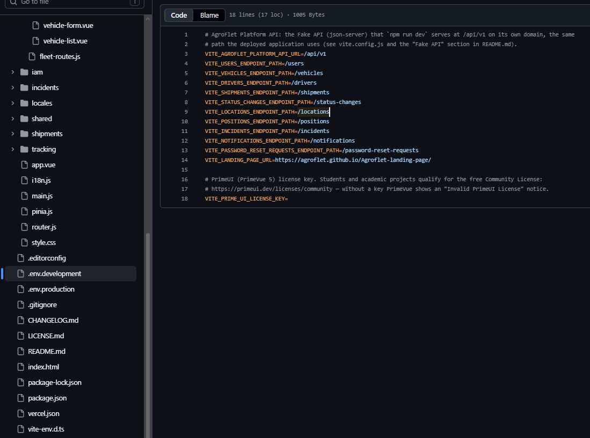
</p>

Ejemplo vue de Sprint 2:
<p align="center">
  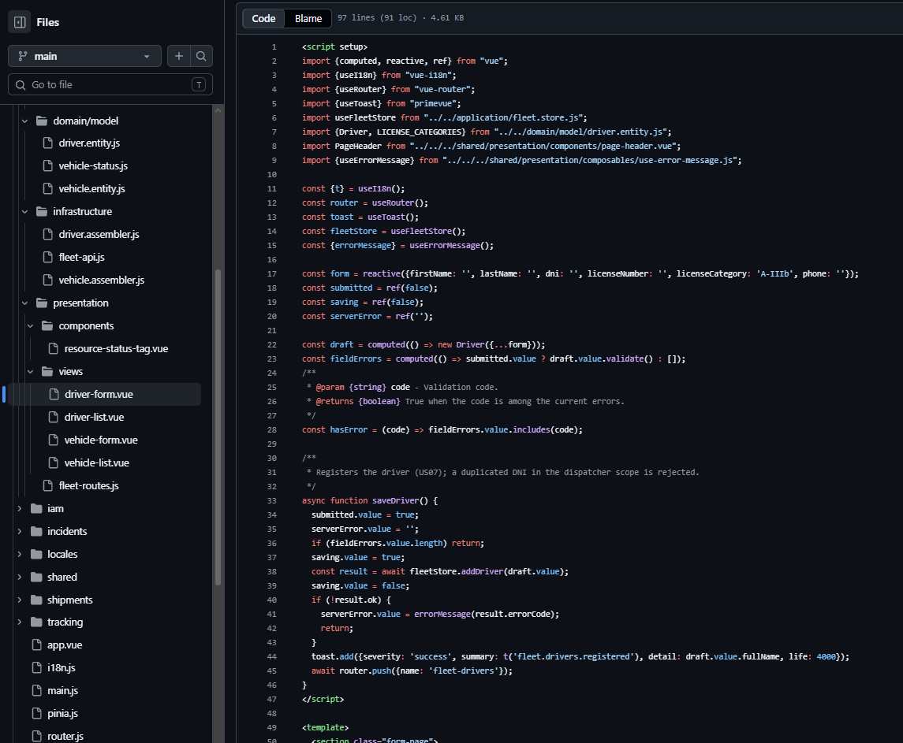
</p>

Ejemplo de .js de Sprint 2:
<p align="center">
  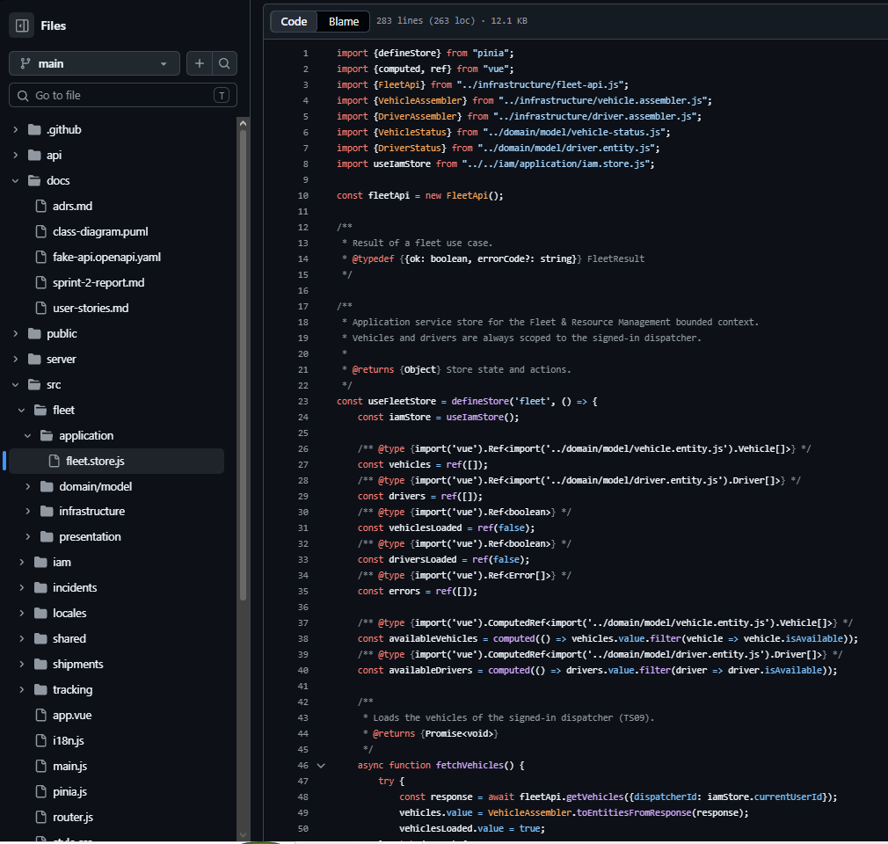
</p>

Ejemplo de .env de Sprint 2:
<p align="center">
  
</p>

Pull Request sprint 2:
<p align="center">
  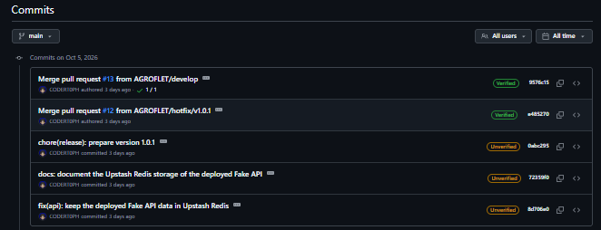
</p>
<p align="center">
  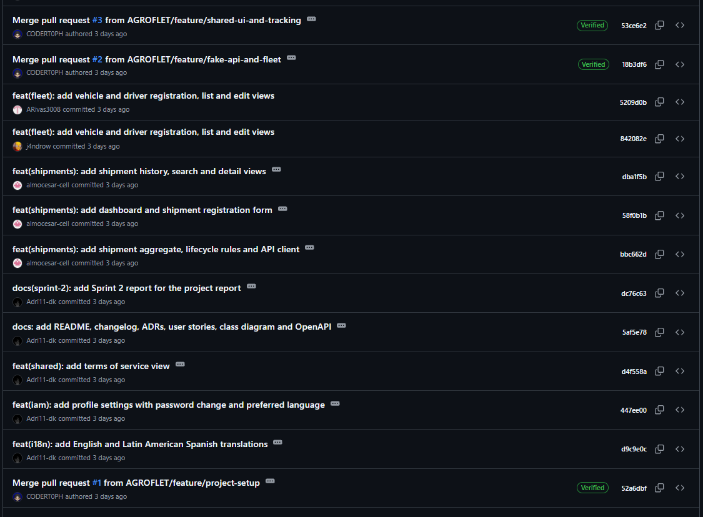
</p>


#### 5.2.2.5. Execution Evidence for Sprint Review

La versión de demostración permite recorrer las funcionalidades según el rol. Las siguientes vistas sirven como evidencia de ejecución y deben acompañarse con capturas propias de la versión desplegada.

| Vista / acción | Ruta o evidencia | User Stories |
| :--- | :--- | :--- |
| Registro, acceso y recuperación | `/iam/sign-up`, `/iam/sign-in`, `/iam/password-recovery` | US01–US04, US34 |
| Panel principal y gestión de envíos | `/dashboard`, `/shipments/new`, `/shipments/:id` | US08–US12, US31 |
| Vehículos y conductores | `/fleet/vehicles`, `/fleet/drivers` | US05–US07 |
| Historial y búsqueda | `/shipments` | US15–US16 |
| Mapa, ruta e incidencias | Detalle de envío, mapa y diálogos | US13–US14, US17–US18, US32 |
| Alertas de operaciones | `/notifications` | US19–US20 |
| Cuenta, idioma y condiciones | `/iam/profile`, `/terms` | US21–US23, US33 |


Vista de Web:
<p align="center">
  
</p>

**Sección comprador:**
Envíos entrantes:
<p align="center">
  
</p>

Historial:
<p align="center">
  
</p>

Notificaciones:
<p align="center">
  
</p>

Configuración: 
<p align="center">
  
</p>

---
**Sección despachador:**
Panel:
<p align="center">
  
</p>

Envíos:
<p align="center">
  
</p>

Registrar envío:
<p align="center">
  
</p>

Vehículos:
<p align="center">
  
</p>

Registrar vehículo:
<p align="center">
  
</p>

Conductores:
<p align="center">
  
</p>

Registrar conductor:
<p align="center">
  
</p>

Notificaciones:
<p align="center">
  
</p>

Configuración:
<p align="center">
  
</p>

**Revisión de calidad de las evidencias de ejecución — observaciones de TB1**

El profesor identificó una insignia flotante roja con el texto `Invalid PrimeUI License` en las capturas de **Login, Espacio del Comprador, Panel del Despachador, Vehículos, Conductores, Notificaciones y Configuración**. Estas imágenes se conservan como **evidencia histórica de TB1** y no se presentan como capturas corregidas. La señalización visual debe resolverse en el producto y verificarse en su URL pública antes de obtener evidencias nuevas.

| Hallazgo | Causa o punto de verificación | Acción requerida para AV2 | Evidencia de cierre |
| :--- | :--- | :--- | :--- |
| Insignia `Invalid PrimeUI License` | El archivo `.env.production` incluye `VITE_PRIME_UI_LICENSE_KEY=` sin valor; GitHub Actions permite configurar `PRIME_UI_LICENSE_KEY`. | Verificar el tipo de licencia aplicable, obtener y configurar una clave válida en los entornos de publicación, generar una nueva compilación y comprobar que el aviso ya no aparezca. | Captura del despliegue y capturas nuevas de todas las vistas observadas. |
| Capturas con elemento visual ajeno a la interfaz | Material gráfico de TB1 no corregido. | Registrar las nuevas capturas únicamente después de verificar las pantallas desplegadas y su aspecto responsive. | Conjunto de imágenes renovadas y fechadas en el informe AV2. |
| Nombre del archivo de presentación duplicado | Se entregó una extensión repetida (`.pptx.pptx`). | Guardar la presentación de la siguiente entrega con una sola extensión `.pptx` y generar su versión `.pdf` con el mismo nombre base. | Nombres de los archivos adjuntados en la actividad AV2. |

No se debe atribuir a esta modificación documental la eliminación efectiva del aviso ni la sustitución física de las capturas: ambas dependen de la actualización de la configuración y de nueva evidencia del producto.

---

#### 5.2.2.6. Services Documentation Evidence for Sprint Review

Durante el Sprint 2 (TB1), la Web Application de AgroFlet consume una **Fake API** basada en `json-server` 0.17. Este servicio permite desarrollar y demostrar los flujos de los segmentos Despachador y Comprador antes de integrar el RESTful API definitivo. A diferencia de un backend productivo, las reglas de negocio y las restricciones de acceso de esta versión se aplican principalmente desde el frontend.

La documentación del servicio simulado se encuentra en el archivo [`docs/fake-api.openapi.yaml`](https://github.com/AGROFLET/Agroflet-frontend-application/blob/main/docs/fake-api.openapi.yaml), con **OpenAPI 3.0.3** y versión de contrato **1.0.0**. El documento describe rutas, métodos HTTP, parámetros, cuerpos de solicitud, esquemas, respuestas y ejemplos. Sus operaciones identifican las Technical Stories que emulan; esto documenta el mock utilizado en TB1, no acredita la implementación del futuro backend ASP.NET Core.

**Ubicación y configuración del servicio**

| Entorno | URL base | Configuración verificable |
| :--- | :--- | :--- |
| Desarrollo integrado con Vite | `/api/v1` en el servidor de `npm run dev` o `npm run preview` | Fake API servida desde Vite. |
| JSON Server independiente | `http://localhost:3000/api/v1` | `npm run server`; datos de `server/db.json`. |
| Demostración publicada | [https://agroflet-frontend-application.vercel.app/api/v1](https://agroflet-frontend-application.vercel.app/api/v1) | Vercel Function en `api/index.js`. |

El archivo [`server/routes.json`](https://github.com/AGROFLET/Agroflet-frontend-application/blob/main/server/routes.json) transforma `/api/v1/*` en los recursos de JSON Server. El [README técnico](https://github.com/AGROFLET/Agroflet-frontend-application#fake-api-json-server) explica las diferencias de persistencia entre los modos locales y el despliegue. La función publicada admite almacenamiento compartido mediante Upstash Redis cuando la integración está configurada; sin ella utiliza datos por instancia. El código y la documentación de esa configuración no sustituyen una evidencia del estado de la base de datos en el panel de Vercel.

**Recursos documentados por contexto**

Las rutas de la tabla son relativas a la URL base `/api/v1`. Los métodos corresponden al contrato OpenAPI existente.

| Contexto | Recurso | Métodos documentados | Uso en la Web Application |
| :--- | :--- | :--- | :--- |
| IAM | `/users`, `/users/{id}` | GET y POST en colección; GET y PATCH por ID | Registro, consulta de cuentas, sesión demostrativa y actualización de perfil. |
| IAM | `/password-reset-requests`, `/password-reset-requests/{id}` | GET y POST en colección; PATCH por ID | Solicitudes de recuperación y actualización de su estado. |
| Fleet | `/vehicles`, `/vehicles/{id}` | GET y POST en colección; GET y PATCH por ID | Registro, consulta y actualización de vehículos y disponibilidad. |
| Fleet | `/drivers`, `/drivers/{id}` | GET y POST en colección; GET y PATCH por ID | Registro, consulta y actualización de conductores. |
| Shipments | `/locations` | GET | Catálogo de origen y destino. |
| Shipments | `/shipments`, `/shipments/{id}` | GET y POST en colección; GET, PATCH y DELETE por ID | Envíos, filtros y actualización de operaciones. El DELETE documentado no equivale al flujo de cancelación del frontend. |
| Shipments | `/status-changes` | GET y POST | Historial de cambios de estado. |
| Tracking | `/positions` | GET y POST | Consulta y registro de posiciones reportadas. |
| Incidents | `/incidents` | GET y POST | Registro y consulta de incidencias. |
| Incidents | `/notifications`, `/notifications/{id}` | GET y POST en colección; PATCH por ID | Alertas y marcado de notificaciones como leídas. |

El contrato también incluye `POST /contact-messages`. Sin embargo, el formulario UH28 de la Landing Page V2 guarda la demostración en `localStorage`, bajo `agroflet_contacts`; **no consume ese endpoint**. La existencia del recurso en OpenAPI no demuestra una integración de la landing con el servicio.

**Procedimiento reproducible de consulta de la documentación**

1. Abrir el repositorio del frontend y ejecutar `npm install`.
2. Iniciar la Fake API independiente mediante `npm run server`.
3. Abrir `docs/fake-api.openapi.yaml` en Swagger Editor o en el editor compatible de WebStorm.
4. Seleccionar el servidor `http://localhost:3000/api/v1` y consultar un recurso, por ejemplo `GET /locations` o `GET /shipments?dispatcherId=1`.
5. Contrastar el resultado con los esquemas y respuestas del contrato. Las solicitudes de escritura deben realizarse únicamente con datos de prueba.

Ejemplos de consulta de solo lectura contra el servicio local:

```http
GET http://localhost:3000/api/v1/locations
GET http://localhost:3000/api/v1/shipments?dispatcherId=1
GET http://localhost:3000/api/v1/positions?shipmentId=1
```

Estos ejemplos indican cómo reproducir la revisión; no se presentan como resultados de pruebas HTTP ejecutadas en esta actualización del informe. La evidencia documental comprobada es el contrato OpenAPI almacenado en GitHub y su correspondencia con la configuración del mock.

**Alcance y limitaciones de TB1**

- La autenticación es emulada sobre la colección `users`. Aunque el cliente envía un encabezado Bearer, JSON Server no valida el token ni aplica autorización productiva.
- La recuperación de contraseña no cuenta todavía con un servicio de correo. El enlace demostrativo de restablecimiento solo se muestra en desarrollo.
- Las ubicaciones representan posiciones reportadas o datos marcados como demostrativos; no acreditan telemetría GPS automática.
- La documentación OpenAPI del mock no se presenta como Swagger de un RESTful API ASP.NET Core ya desplegado.

---

#### 5.2.2.7. Software Deployment Evidence for Sprint Review

Durante el Sprint 2 (TB1) se publicó la primera versión de la Web Application de AgroFlet y se actualizó la Landing Page V2. La Web Application se encuentra disponible en Vercel y GitHub Pages; la Fake API utilizada por ambas publicaciones del frontend se aloja en Vercel. La landing constituye un producto separado, desarrollado con HTML, CSS y JavaScript.

**Productos y direcciones de publicación**

| Producto | Repositorio | URL pública | Evidencia disponible |
| :--- | :--- | :--- | :--- |
| Landing Page V2 | [Agroflet-landing-page](https://github.com/AGROFLET/Agroflet-landing-page) | [Landing Page](https://agroflet.github.io/Agroflet-landing-page/) | Workflow `pages.yml`, ejecución exitosa de GitHub Actions y commits del formulario UH28. |
| Web Application en Vercel | [Agroflet-frontend-application](https://github.com/AGROFLET/Agroflet-frontend-application) | [Web Application](https://agroflet-frontend-application.vercel.app/) | `vercel.json` y captura de Production Deployment con estado Ready. |
| Web Application en GitHub Pages | [Agroflet-frontend-application](https://github.com/AGROFLET/Agroflet-frontend-application) | [Web Application en Pages](https://agroflet.github.io/Agroflet-frontend-application/) | Workflow `deploy-github-pages.yml` y ejecución exitosa de GitHub Actions. |
| Fake API | Incluida en el repositorio del frontend | [Fake API (envíos)](https://agroflet-frontend-application.vercel.app/api/v1/shipments) | `api/index.js`, `server/routes.json`, `server/db.json` y contrato OpenAPI. |
| RESTful API definitivo | Implementación posterior al alcance acreditado de TB1 | Sin despliegue acreditado en esta sección | Se mantiene separado de la Fake API. |

**Recursos de la Fake API**

La Fake API se publica como una Vercel Function con json-server. Todos los recursos usan el prefijo `https://agroflet-frontend-application.vercel.app/api/v1/`.

| Recurso | Endpoint público |
| :--- | :--- |
| Usuarios | [/api/v1/users](https://agroflet-frontend-application.vercel.app/api/v1/users) |
| Solicitudes de recuperación de contraseña | [/api/v1/password-reset-requests](https://agroflet-frontend-application.vercel.app/api/v1/password-reset-requests) |
| Vehículos | [/api/v1/vehicles](https://agroflet-frontend-application.vercel.app/api/v1/vehicles) |
| Conductores | [/api/v1/drivers](https://agroflet-frontend-application.vercel.app/api/v1/drivers) |
| Ubicaciones | [/api/v1/locations](https://agroflet-frontend-application.vercel.app/api/v1/locations) |
| Envíos | [/api/v1/shipments](https://agroflet-frontend-application.vercel.app/api/v1/shipments) |
| Cambios de estado | [/api/v1/status-changes](https://agroflet-frontend-application.vercel.app/api/v1/status-changes) |
| Posiciones GPS | [/api/v1/positions](https://agroflet-frontend-application.vercel.app/api/v1/positions) |
| Incidencias | [/api/v1/incidents](https://agroflet-frontend-application.vercel.app/api/v1/incidents) |
| Notificaciones | [/api/v1/notifications](https://agroflet-frontend-application.vercel.app/api/v1/notifications) |

La dirección `https://agroflet.github.io/Agroflet-frontend-application/` corresponde a la **Web Application**, no a la Landing Page. Esta distinción permite identificar y revisar cada producto de la entrega.

**1. Configuración y evidencia de Vercel**

El archivo [`vercel.json`](https://github.com/AGROFLET/Agroflet-frontend-application/blob/main/vercel.json) establece la configuración reproducible del frontend:

```text
Framework: Vite / Vue
Build command: npm run build
Output directory: dist
API rewrite: /api/v1/:path* -> /api
SPA rewrite: /(.*) -> /index.html
Production API base: /api/v1
```

La primera reescritura dirige las solicitudes del mock a la Vercel Function. La segunda permite que las rutas internas de Vue Router sean atendidas por la SPA. El despliegue incluye los archivos JSON del directorio `server/` necesarios para inicializar los datos demostrativos.

<p align="center">
  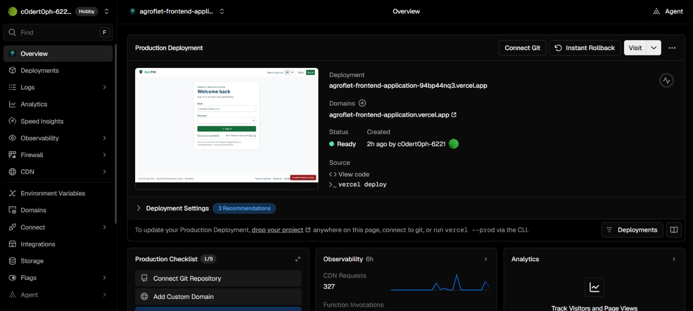
</p>

*Figura. El panel muestra el dominio agroflet-frontend-application.vercel.app, el estado Ready y la fuente «vercel deploy». También aparece la opción «Connect Git». La captura acredita una publicación por CLI; no acredita que el proyecto estuviera conectado a GitHub ni que cada push a main generara un despliegue automático de Vercel.*

El procedimiento reproducible documentado en el repositorio es:

```bash
npm install
npm run build
vercel login
vercel link
vercel --prod
```

La conexión Git de Vercel puede configurarse posteriormente para automatizar publicaciones. En esta sección se diferencia esa posibilidad del método acreditado por la captura. La evidencia Ready no se utiliza para afirmar que todos los endpoints fueron probados.

**2. Publicación de la Web Application en GitHub Pages**

El workflow [`deploy-github-pages.yml`](https://github.com/AGROFLET/Agroflet-frontend-application/blob/main/.github/workflows/deploy-github-pages.yml) se ejecuta ante un push a `main` o mediante `workflow_dispatch`. Sus pasos son:

1. Obtener el código y configurar Node.js 22.
2. Instalar dependencias con `npm ci`.
3. Compilar con `npm run build -- --base "/Agroflet-frontend-application/"`.
4. Configurar `VITE_AGROFLET_PLATFORM_API_URL` hacia la Fake API pública de Vercel, salvo que una variable del repositorio la reemplace.
5. Copiar `dist/index.html` a `dist/404.html` para permitir que las rutas internas abran la SPA.
6. Publicar `dist/` mediante las acciones oficiales de GitHub Pages.

GitHub Pages solo sirve contenido estático: la aplicación publicada allí consume el servicio simulado en Vercel. Las rutas internas atendidas mediante `404.html` pueden devolver un estado HTTP 404 aunque Vue Router muestre la pantalla; es una limitación de ese mecanismo de publicación.

**Evidencia de ejecución:** [Deploy to GitHub Pages — run 37274392426](https://github.com/AGROFLET/Agroflet-frontend-application/actions/runs/37274392426), asociado al commit [9576c15](https://github.com/AGROFLET/Agroflet-frontend-application/commit/9576c150b6098f9e41741793138f363d0be44473). La consulta del historial de GitHub Actions realizada para esta corrección confirmó estado `completed` y conclusión `success`.

**3. Actualización y despliegue de la Landing Page V2**

La landing conserva sus secciones de presentación, planes, testimonios, solución, equipo y videos. En TB1 se incorporó el formulario UH28 después de Videos, con validaciones, textos ES/EN y guardado demostrativo en el navegador. El formulario utiliza el azul de las secciones alternadas del sitio.

El workflow [`pages.yml`](https://github.com/AGROFLET/Agroflet-landing-page/blob/main/.github/workflows/pages.yml) revisa los archivos estáticos y la sintaxis JavaScript, prepara `index.html`, `assets/`, `docs/` y `.nojekyll`, y publica el artefacto en GitHub Pages. No requiere compilar la landing con Vite.

| Cambio de la Landing V2 | Evidencia trazable |
| :--- | :--- |
| Incorporación de UH28 después de Videos | [Pull Request #3, integrado](https://github.com/AGROFLET/Agroflet-landing-page/pull/3) |
| Adaptación al fondo azul existente | [Commit 57ce8f6](https://github.com/AGROFLET/Agroflet-landing-page/commit/57ce8f64dc7b85182205a85d157b8cb0ccab3ef6) |
| Actualización del enlace de estilos para renovar la caché | [Commit a98634a](https://github.com/AGROFLET/Agroflet-landing-page/commit/a98634ad38250b15129f87bd6af06076bbdc6f7b) |
| Publicación de la actualización | [Deploy AgroFlet to GitHub Pages — run 37855277906](https://github.com/AGROFLET/Agroflet-landing-page/actions/runs/37855277906), estado `completed`, conclusión `success` |

Las evidencias anteriores permiten revisar por separado la configuración, el resultado del despliegue y los cambios del producto. Los flujos de la aplicación se documentan en 5.2.2.5; el alcance del servicio simulado y sus limitaciones se describen en 5.2.2.6. La publicación de una interfaz o de un mock no se atribuye al backend definitivo.

---

#### 5.2.2.8. Team Collaboration Insights during Sprint

Durante el Sprint 2 el equipo distribuyó el desarrollo de la aplicación web frontend (Single-Page Application) en aspectos técnicos y funcionales claramente delimitados: configuración de la arquitectura modular en Vue, diseño de componentes de UI con PrimeVue, gestión de estado reactivo con Pinia, integración con el Fake API Server, renderizado de mapas interactivos con Leaflet, internacionalización y despliegue continuo en la nube.

**Actividades de implementación desarrolladas:**

* **Estructuración arquitectónica y de dominio:** se establecieron los Bounded Contexts del proyecto (`iam`, `fleet`, `shipments`, `tracking` e `incidents`) dentro de la estructura de carpetas de Vue, aplicando el patrón Assembler/Entity para desacoplar el modelo de dominio de los contratos de transferencia de datos de la API.
* **Desarrollo modular y UI:** la interfaz se construyó mediante componentes reutilizables y vistas adaptadas a cada rol (Despachador para gestión operativa y Comprador Mayorista para consulta y monitoreo), implementando librerías como PrimeVue y vistas clave para la gestión de flota, registro de viajes y dashboards.
* **Simulación e integración asíncrona (Fake API):** se implementó un servidor simulado mediante `json-server` (`server/db.json` y `routes.json`) para exponer los endpoints RESTful (`/api/v1/*`), permitiendo el consumo HTTP asíncrono vía Axios con interceptores de autenticación JWT y manejo centralizado de errores antes de conectar el backend definitivo.
* **Trazabilidad geográfica e incidencias:** se integró la biblioteca Leaflet para renderizar capas cartográficas y rutas terrestres, complementada con el recálculo dinámico de la Hora Estimada de Llegada (ETA) al registrar incidencias o desvíos viales.
* **Gestión de versiones y despliegue continuo:** se mantuvo la metodología GitFlow trabajando sobre ramas de características (`feature/*`) con revisiones mediante Pull Requests hacia `develop`, desplegando la Single-Page Application Vercel.

La separación del código por Bounded Contexts y la utilización de Assemblers permitió que nosotros desarrollaramos funcionalidades en paralelo sin generar conflictos sobre los stores o las rutas del sistema. Como principal aprendizaje del sprint, el equipo reconoció el valor del uso de un Fake API robusto, lo cual evitó cuellos de botella en la integración frontend-backend.

**Analíticas de colaboración en GitHub:**

**1. Evidencia de ramas del repositorio**

<p align="center">
  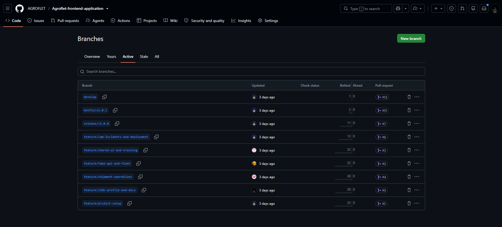
</p>

**2. Historial de commits por integrante**

*Alca Morán, César Alejandro (`CesarAlcaM`)*
<p align="center">
  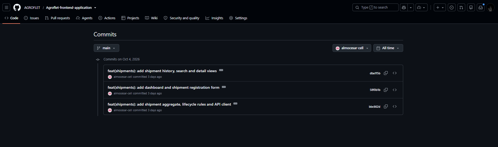
</p>

*Centeno León, Adriano Samir (`AdrianoCenteno`)*
<p align="center">
  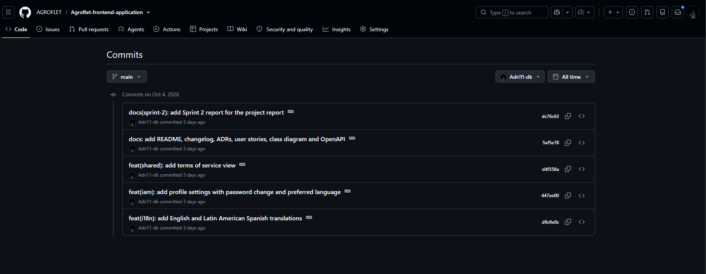
</p>

*Rivas Méndez, Bernie Aarón (`BernieRivasM`)*
<p align="center">
  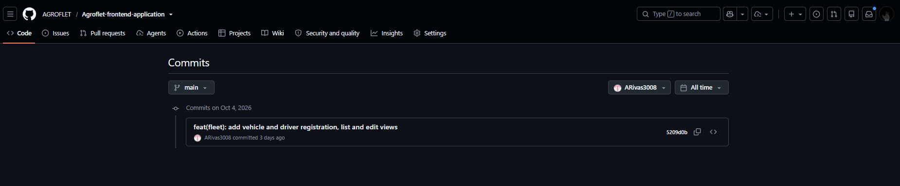
</p>

*Rivas Castillo, Christoper Steven (`ChristoperRivasC`)*
<p align="center">
  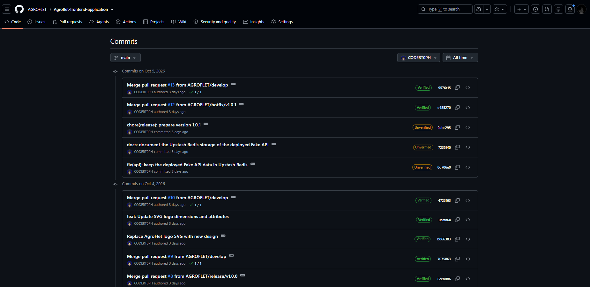
</p>

*Tello Lima, Jose Alejandro (`JoseTelloL`)*
<p align="center">
  
</p>

**3. Colaboradores activos en el repositorio**

*Gráfica de la actividad conjunta del equipo y de la distribución de aportes (adiciones y eliminaciones de código) durante el Sprint 2.*

<p align="center">
   Contributors" width="700">
</p>

**4. Histograma de contribuciones en el tiempo**

*Frecuencia de commits realizados durante el Sprint 2, evidenciando un esfuerzo sostenido y coordinado hacia la integración final.*

<p align="center">
   Commits" width="700">
</p>


---

**Acciones de mejora continua derivadas de la evaluación de TB1 (seguimiento para AV2)**

| Criterio observado | Corrección documental incorporada | Verificación que aún requiere evidencia externa |
| :--- | :--- | :--- |
| Sprint Backlog: `Sprint 2 Velocity` sin consolidar | Se explicita una velocidad documentada de **84 SP**, correspondiente a 28 User Stories finalizadas según el backlog. | Confirmar el cierre del Sprint Board y conservar evidencia de su estado. |
| Software Deployment Configuration: hosting de C# sin concreción | Se establece una **alternativa técnica propuesta** (Azure App Service + Azure Database for MySQL), con criterios de selección, configuración y pruebas de aceptación. | Obtener aprobación del equipo, desplegar realmente el API y registrar URL, capturas y pruebas de su funcionamiento. |
| Calidad visual de las capturas | Se identifica la variable de licencia PrimeUI y se enumeran las siete vistas afectadas. | Regularizar la licencia, configurar los entornos, recompilar, comprobar y reemplazar las capturas de AV2. |
| Nomenclatura de la presentación | Se incorpora la regla de una sola extensión para PowerPoint y un PDF equivalente. | Verificar el nombre real al adjuntar la presentación, por ejemplo `upc-pre-202620-1asi0730-<NRC>-agroflet-keynote-av2.pptx`. |

Estas medidas responden a la retroalimentación del docente sin alterar las evidencias históricas del Sprint 2 ni atribuir avances de implementación no verificados.

5.2.3. Sprint 3
Durante el Sprint 3, correspondiente al incremento de backend previsto para la tercera entrega (AV2), el equipo de AgroFlet aborda la implementación de servicios RESTful en C# 14, ASP.NET Core sobre .NET 10, Entity Framework Core y MySQL. A diferencia del Sprint 1, centrado en la Landing Page, y del Sprint 2, dedicado a la Web Application y a una Fake API con json-server, este sprint documenta los contratos HTTP y las reglas de negocio del servidor. Su finalidad es proporcionar una base persistente, autorizada y verificable para gestionar flotas, envíos, seguimiento e incidencias.

La selección se deriva de la sección 3.1. User Stories del Capítulo III del informe: las historias US01–US34 ya están contempladas en los Sprint Backlogs 1 y 2, mientras que TS01–TS27 constituyen las 27 Technical Stories del RESTful API que todavía no habían sido asignadas a una tabla de Sprint Backlog. No se contabilizan nuevamente las US como historias nuevas; cada TS se vincula con las US que soporta, respetando el Product Backlog original.

Alcance y criterio de lectura: la presencia de código y controladores permite registrar un work item como Done en cuanto a implementación en el repositorio. No implica por sí sola validación integral contra el frontend, disponibilidad de una API pública o aceptación formal del docente. Los estados de pruebas adicionales, integración y despliegue se muestran por separado. Las horas y los Story Points de este documento son una propuesta de estimación documental, porque las TS no tienen puntos asignados en el Product Backlog actual; deben ratificarse por el equipo y reflejarse en la herramienta ágil antes de presentarlos como métricas oficiales.

5.2.3.1. Sprint Planning 3
El Sprint Planning 3 organiza la transición desde el prototipo frontend con Fake API hacia el desarrollo de Web Services reales. Se priorizaron los contratos asociados a autenticación, operaciones de transporte, recursos de flota, incidencias, posiciones y notificaciones, además de infraestructura transversal. La selección considera las dependencias entre bounded contexts: una operación de transporte requiere usuarios, conductor y vehículo; los incidentes y posiciones deben quedar asociados a un envío autorizado; y las notificaciones se originan a partir de eventos del dominio.

Sprint #	Sprint 3
Sprint Planning Background	AV2 — RESTful API de AgroFlet
Date	Por confirmar con el acta del equipo. Fecha de revisión del repositorio: 13/11/2026; no equivale a fecha de reunión.
Time	Por confirmar.
Location	Por confirmar (no se encontró constancia de una reunión específica).
Prepared By	Equipo AgroFlet; responsable de la minuta por confirmar.
Attendees (to planning meeting)	Alca Morán, César Alejandro; Centeno León, Adriano Samir; Rivas Méndez, Bernie Aarón; Rivas Castillo, Christoper Steven; Tello Lima, Jose Alejandro. La asistencia efectiva está pendiente de corroboración.
Sprint 2 Review Summary	Según la sección 5.2.2 del informe, se documentó la primera Web Application en Vue 3/Vite y una Fake API, con funcionalidades de flota, operaciones, seguimiento, incidencias, cuentas y contacto. Las 28 tareas principales del Sprint 2 figuran como finalizadas. Esta declaración no acredita integración con un backend real.
Sprint 2 Retrospective Summary	Como oportunidad de mejora identificada a partir del incremento anterior, es necesario separar las simulaciones del frontend de las responsabilidades del servidor: autorización, persistencia, transacciones, integridad, idempotencia y pruebas de contratos. Se mantiene la organización modular mediante GitFlow, evitando atribuir a cada importación reconstruida una secuencia histórica de desarrollo que no demuestra.
Sprint Goal & Technical Stories	
Sprint 3 Goal	Our focus is on ofrecer una API que permita a despachadores administrar sus recursos y operaciones, informar posiciones e incidencias y compartir estados confiables con compradores autorizados. We believe it delivers trazabilidad y coordinación logística, reduciendo la dependencia de datos simulados. This will be confirmed when los contratos TS01–TS27 estén disponibles en OpenAPI/Scalar, las pruebas automatizadas del incremento terminen sin fallos y se demuestre un flujo autenticado de registro → despacho → inicio → reporte de posición/incidencia → consulta por comprador; el despliegue público se acreditará solo si existe evidencia adicional.
Sprint 3 Velocity	80 SP propuestos para las 27 Technical Stories. Estimación pendiente de aprobación; no debe describirse como velocidad histórica observada.
Sum of Story Points	80 SP propuestos; las tareas técnicas transversales no añaden SP para evitar doble contabilización.
Criterios de cumplimiento del Sprint Goal. Se consideran cuatro niveles de evidencia distintos: (1) código fuente y rutas presentes; (2) compilación y pruebas automatizadas con resultados reproducibles; (3) ejecución manual documentada mediante capturas y respuestas HTTP; y (4) integración y despliegue en un entorno accesible. El repositorio actualmente respalda principalmente los niveles 1 y, mediante su registro de validación, parte del nivel 2. Los niveles 3 y 4 requieren evidencia específica de la entrega.

Estimación propuesta por contexto: IAM 22 SP; Fleet 16 SP; Shipments 21 SP; Tracking/Incidents/Notifications 19 SP; Contact 2 SP. Total: 80 SP. Se excluye el endpoint complementario de ruta planificada como historia nueva porque US18 ya está definida, pero no existe una TS28 en el catálogo actual.

5.2.3.2. Aspect Leaders and Collaborators
Para mantener la trazabilidad entre módulos implementados y responsabilidades, se toma como referencia la autoría consignada en los commits del backend y en los README de cada módulo. La matriz que sigue es una propuesta de LACX para el Sprint 3: la asignación de líderes coincide con los módulos atribuidos en GitHub, mientras que las colaboraciones sugeridas deben confirmarse en la reunión del equipo.

L: Aspect Leader; C: Collaborator propuesto; —: sin tarea asignada directamente en esta matriz.

Team Member	GitHub Username	IAM	Fleet	Shipments	Tracking & Incidents	Quality, API Docs & Deployment
Rivas Méndez, Bernie Aarón	ARivas3008	L	—	—	—	C
Centeno León, Adriano Samir	Adri11-dk	—	L	C	—	C
Alca Morán, César Alejandro	almocesar-cell	—	C	L	C	C
Tello Lima, Jose Alejandro	j4ndrow	—	—	C	L	C
Rivas Castillo, Christoper Steven	CODERT0PH	C	C	C	C	L
La implementación por contextos comprende IAM (cuentas, JWT, recuperación y perfil), Fleet (vehículos y conductores), Shipments (registro, estado, consulta y filtros), Tracking & Incidents (posiciones, incidencias y notificaciones) y Quality & Deployment (composición, pruebas, OpenAPI, documentación y preparación de infraestructura). El módulo Contact está incluido entre los componentes compartidos integrados por Christoper.

Evidencias de liderazgo documentado: IAM — Bernie, Fleet — Adriano, Shipments — César, Tracking/Incidents — José e infraestructura y pruebas — Christoper.

5.2.3.3. Sprint Backlog 3
El Sprint Backlog 3 agrupa las 27 Technical Stories que no se utilizaron en las tablas de los Sprints 1 y 2. Para conservar el formato del Sprint Backlog 1, se especifican User Story Id, User Story Title, Work Item/Task Id, título, descripción, estimación en horas, responsable y estado; se agregan los Story Points propuestos y el vínculo con las historias de usuario del Capítulo III para mejorar la trazabilidad.

Sprint Board: PENDIENTE — agregar enlace público del Sprint 3 en Jira/Trello/YouTrack y captura real del tablero. No se ha verificado una URL de tablero específica del Sprint 3; no corresponde reemplazarla por una captura inventada.

User Story Id	User Story Title	Work Item / Task Id	Work Item / Task Title	Description	Estimation (h)	SP propuestos	Assigned To	Status
TS01	POST /api/v1/auth/register	T01	Registro de usuarios en API	Implementar alta con userType dispatcher/buyer, correo único, validación de campos y respuesta sin contraseña ni hash; soporta US01.	5	3	Bernie Rivas	Done
TS02	POST /api/v1/auth/login	T02	Autenticación JWT	Comprobar credenciales, emitir accessToken y expiresIn, devolver perfil mínimo y rechazar accesos incorrectos; soporta US02.	5	3	Bernie Rivas	Done
TS03	GET /api/v1/shipments	T03	Consulta paginada de envíos	Publicar colección con data, totalRecords, currentPage, pageSize, totalPages y aislamiento por participante; soporta US10.	5	3	César Alca	Done
TS04	POST /api/v1/shipments	T04	Creación transaccional de despachos	Validar carga, comprador, ruta, conductor, vehículo y capacidad; crear envío planned y reservar recursos de forma atómica; soporta US09.	8	5	César Alca	Done
TS05	GET /api/v1/shipments/{id}	T05	Detalle autorizado de envío	Recuperar el envío y sus proyecciones permitidas, sin revelar datos privados del conductor al comprador; soporta US11.	5	3	César Alca	Done
TS06	PATCH /api/v1/shipments/{id}/status	T06	Ciclo de vida y control de concurrencia	Validar transiciones, expectedVersion, motivo de cancelación, historial y liberación de recursos; soporta US12 y US31.	8	5	César Alca	Done
TS07	POST /api/v1/shipments/{id}/incidents	T07	Registro idempotente de incidencias	Registrar tipo, descripción, demora y clave de idempotencia; actualizar ETA una sola vez y rechazar operaciones incompatibles; soporta US13.	8	5	José Tello	Done
TS08	GET /api/v1/shipments/{id}/incidents	T08	Historial de incidencias	Listar eventos por fecha descendente, incluso cuando no haya datos, respetando el ámbito del usuario; soporta US14.	4	2	José Tello	Done
TS09	GET /api/v1/vehicles	T09	Consulta de flota autorizada	Exponer vehículos, disponibilidad y proyecciones por ámbito de autorización para preparar despachos; soporta US05 y US08.	4	2	Adriano Centeno	Done
TS10	POST /api/v1/vehicles	T10	Registro de vehículos	Persistir placa, marca, modelo, año, capacidad, carrocería y estado available, validando duplicados; soporta US05.	5	3	Adriano Centeno	Done
TS11	GET /api/v1/drivers	T11	Consulta de conductores	Recuperar conductores y disponibilidad; restringir datos personales según rol y relación con la operación; soporta US07 y US08.	4	2	Adriano Centeno	Done
TS12	POST /api/v1/drivers	T12	Registro de conductores	Crear conductor con identidad, licencia y contacto; impedir duplicados dentro del ámbito correspondiente; soporta US07.	5	3	Adriano Centeno	Done
TS13	GET /api/v1/shipments con filtros	T13	Filtros y búsqueda del historial	Implementar filtros de carga, estado, destino, fechas y término de búsqueda sin saltarse autorización ni paginación; soporta US15 y US16.	5	3	César Alca	Done
TS14	GET /api/v1/shipments/active/locations	T14	Últimas posiciones autorizadas	Proyectar latitud, longitud, fecha, fuente y isStale para operaciones activas; indicar explícitamente ausencia de posición; soporta US17.	5	3	José Tello	Done
TS15	GET /api/v1/notifications	T15	Consulta de avisos	Publicar notificaciones del usuario con filtro isRead, aislando los destinatarios; soporta US19 y US20.	4	2	José Tello	Done
TS16	PATCH /api/v1/notifications/{id}/read	T16	Confirmación de lectura	Marcar un aviso como leído preservando readAt ante reintentos e impedir cambios de avisos ajenos; soporta US19 y US20.	4	2	José Tello	Done
TS17	GET /api/v1/users/profile	T17	Consulta de perfil propio	Recuperar datos de la identidad del JWT y su idioma preferido, rechazando solicitudes sin sesión; soporta US21 y US23.	4	2	Bernie Rivas	Done
TS18	PUT /api/v1/users/profile	T18	Actualización de perfil	Permitir cambios en datos editables e idioma es/en, impidiendo alterar el rol o los datos de otra cuenta; soporta US21 y US23.	5	3	Bernie Rivas	Done
TS19	PATCH /api/v1/vehicles/{id}/status	T19	Estado operativo del vehículo	Permitir alternancia available/under_maintenance y bloquear cambios si el vehículo está reservado o en ruta; soporta US06.	5	3	Adriano Centeno	Done
TS20	GET /api/v1/shipments/{id}/status-history	T20	Historial de estados de operación	Exponer transición anterior/nueva, fecha y actor sin revelar operaciones ajenas; soporta US11.	4	2	César Alca	Done
TS21	POST /api/v1/auth/logout	T21	Revocación de sesión	Invalidar el JWT actual por su jti y comprobar que ya no autoriza nuevas operaciones; soporta US03.	4	2	Bernie Rivas	Done
TS22	POST /api/v1/auth/password-reset-requests	T22	Solicitud segura de recuperación	Responder de forma genérica, generar token temporal y aplicar rate limiting sin revelar cuentas existentes; soporta US04.	5	3	Bernie Rivas	Done
TS23	POST /api/v1/auth/password-resets	T23	Restablecimiento mediante token	Validar vigencia y uso único del token, actualizar contraseña, invalidar sesiones y rechazar tokens usados; soporta US04.	5	3	Bernie Rivas	Done
TS24	PUT /api/v1/users/password	T24	Cambio de contraseña autenticado	Exigir contraseña actual, validar nueva credencial y revocar sesiones anteriores; soporta US22.	5	3	Bernie Rivas	Done
TS25	PUT /api/v1/vehicles/{id}	T25	Edición segura de vehículo	Actualizar únicamente datos editables, conservar propietario y reserva, y rechazar cambios incompatibles con cargas asignadas; soporta US06.	5	3	Adriano Centeno	Done
TS26	POST /api/v1/shipments/{id}/positions	T26	Registro idempotente de posición	Validar coordenadas, reportedAt, fuente y eventId; impedir duplicaciones y reportes en envíos cerrados; soporta US32.	8	5	José Tello	Done
TS27	POST /api/v1/contact-messages	T27	Recepción persistente de consultas	Registrar nombre, email y mensaje del visitante, aplicar validación/rate limiting y evitar publicar los mensajes; soporta US28.	4	2	Christoper Rivas	Done
Nota de estados: Done expresa que el contrato y su lógica asociada están presentes en main según la inspección de código, controladores y documentación técnica. No equivale a que todas las TS hayan superado manualmente cada escenario Gherkin, a que el frontend esté conectado ni a que exista despliegue público. Las pruebas y verificaciones pendientes se detallan en los work items transversales.

Resumen de estimaciones por responsable (propuesta): Bernie, 8 TS / 38 h / 22 SP; Adriano, 6 TS / 28 h / 16 SP; César, 6 TS / 35 h / 21 SP; José, 6 TS / 33 h / 19 SP; Christoper, 1 TS / 4 h / 2 SP. Total: 27 TS / 138 horas estimadas / 80 SP propuestos. Las horas son estimaciones, no horas de trabajo comprobadas.

Work items técnicos complementarios (sin Story Points adicionales):

Task Id	Task Title	Description	Estimation (h)	Assigned To	Status
TT01	Estructura DDD y configuración del servidor	Componer los contextos Iam, Fleet, Shipments, Tracking, Incidents, Contact y Shared, con controladores, servicios, repositorios y DI.	7	Christoper Rivas	Done
TT02	Persistencia y migraciones compatibles	Configurar EF Core/MySQL, Unit of Work y cadena de migraciones InitialCreate → AlignAv2Contracts, conservando datos existentes.	8	César Alca	Done
TT03	Pruebas automatizadas reproducibles	Ejecutar dotnet test, archivar resultados y capturas del estado real de compilación y las pruebas en un ambiente de la entrega.	8	Christoper Rivas	To-Review
TT04	OpenAPI y Scalar	Publicar el esquema /openapi/v1.json, la interfaz /scalar/v1 y las rutas de comprobación de salud del backend.	4	Christoper Rivas	Done
TT05	Validación externa de Mapbox	Verificar con un token propio la consulta de ruta planificada de US18 y documentar respuesta real, errores y límites; no suponer GPS continuo.	5	José Tello	To-Do
TT06	Configuración de despliegue Render	Preparar Dockerfile, render.yaml, variables de entorno, MySQL remoto y healthCheckPath; obtener evidencia de servicio público solo tras publicarlo.	6	Christoper Rivas	In-Process
TT07	Integración del frontend con la API real	Sustituir los contratos de Fake API, utilizar JWT, paginación y control de versiones; realizar flujo extremo a extremo en una URL verificable.	10	Christoper Rivas / César Alca	To-Do
TT08	Evidencias de demostración y servicio	Obtener capturas de pruebas HTTP, Scalar, respuestas, commits, ramas, PRs y video de ejecución sin exponer credenciales.	5	Equipo AgroFlet	To-Do
TT09	Registro del Sprint Board 3	Agregar enlace público, captura del tablero, responsables y estados reales en la herramienta de gestión utilizada por el grupo.	2	Equipo AgroFlet	To-Do
TT10	Revisión de seguridad e integración	Revisar aislamiento por rol, errores, idempotencia, SMTP real si se configura y recuperación de contraseña en entorno no local.	6	Bernie Rivas / Christoper Rivas	To-Review
Las tareas TT05 y TT07 no se declaran finalizadas: el repositorio especifica que la llamada autenticada real a Mapbox no fue probada y que el frontend existente no fue modificado ni integrado con este backend. De manera similar, el Blueprint de Render constituye preparación técnica, no una prueba de publicación exitosa.

5.2.3.4. Development Evidence for Sprint Review
Se revisó el repositorio AGROFLET/Agroflet-backend-application, incluidas sus ramas main, develop, feature/iam, feature/fleet, feature/shipments, feature/tracking-incidents y feature/quality-deploy. El backend presenta contextos delimitados y una estructura por capas Domain, Application, Infrastructure e Interfaces; en la composición común aparecen persistencia relacional, autorización JWT, eventos internos, protección contra solicitudes abusivas, pruebas y documentación OpenAPI.

Repository	Branch o ámbito	Commit Id	Commit Message	Commit Message Body / alcance verificado	Committed on (UTC)
AGROFLET/Agroflet-backend-application	feature/iam	32e4e4f	feat(iam): import team implementation	Importación reconstruida del módulo IAM con autoría atribuida a Bernie; contiene servicios de autenticación, tokens, perfiles y recuperación. El mensaje aclara que no se afirma una nueva implementación en ese commit.	13/11/2026
AGROFLET/Agroflet-backend-application	feature/fleet	532a1f9	feat(fleet): import team implementation	Importación reconstruida de vehículos, conductores, comandos, consultas, repositorios y eventos, atribuida a Adriano.	13/11/2026
AGROFLET/Agroflet-backend-application	feature/shipments	65e604d	feat(shipments): import team implementation	Importación reconstruida de operaciones, historial, validación y migraciones, atribuida a César.	13/11/2026
AGROFLET/Agroflet-backend-application	feature/tracking-incidents	e99a839	feat(tracking-incidents): import team implementation	Importación reconstruida de Tracking e Incidents, atribuida a José; incluye posiciones, incidentes y notificaciones.	13/11/2026
AGROFLET/Agroflet-backend-application	feature/quality-deploy / integración	d4164ab	build(quality): import shared platform, tests, documentation and deployment	Importación de la composición Shared, Contact, pruebas y configuración transversal; autoría de Christoper.	13/11/2026
AGROFLET/Agroflet-backend-application	feature/quality-deploy	f0a4a78	build(deploy): add free Render blueprint for remote MySQL demo	Añade instrucciones y render.yaml para preparar un servicio de demostración; no certifica servicio publicado.	13/11/2026
AGROFLET/Agroflet-backend-application	feature/iam	5d795c2	docs(iam): explain API contracts and module validation	Documentación de contratos, autorización y pruebas manuales propuestas por Bernie.	13/11/2026
AGROFLET/Agroflet-backend-application	feature/fleet	139745c	docs(fleet): explain API contracts and module validation	Documentación técnica de vehículos y conductores por Adriano.	13/11/2026
AGROFLET/Agroflet-backend-application	feature/shipments	7653db5	docs(shipments): explain API contracts and module validation	Documentación de operaciones, paginación, estados y persistencia por César.	13/11/2026
AGROFLET/Agroflet-backend-application	feature/tracking-incidents	4be24fc	docs(tracking-incidents): explain API contracts and module validation	Documentación de tracking, incidentes, idempotencia y límites por José.	13/11/2026
Pull requests y flujo de integración: PR #1 — Import AgroFlet backend and package it for Render, integrado a develop; PR #2 — Release AgroFlet backend with Scalar, integrado de develop hacia main; y PR #3 — Document Render and Scalar evidence, integrado a develop. También existen commits posteriores de integración y documentación de módulos.

Precisión sobre la colaboración: los mensajes de los cuatro commits de importación indican expresamente que se reconstruyó un historial desde una implementación preexistente y con la autoría que proporcionó el equipo. Es válido usarlos para localizar el código y su atribución documental, pero no para sostener que cada funcionalidad fue programada desde cero el 13/11/2026, ni que la frecuencia de esos commits representa el ritmo histórico original de colaboración. Para satisfacer la rúbrica, se deben sumar capturas verídicas de Insights > Contributors, Network, ramas y PRs, y explicar las contribuciones efectivamente comprobables.

Archivos técnicos representativos:

Área	Archivos del repositorio para mostrar en la revisión	Evidencia que aportan
Autenticación	Iam/Interfaces/Rest/AuthenticationController.cs, Iam/README.md	Registro, acceso, cierre, contraseñas y JWT.
Flota	Fleet/Interfaces/Rest/VehiclesController.cs, Fleet/Interfaces/Rest/DriversController.cs	Altas, consultas y actualizaciones de vehículos y conductores.
Operaciones	Shipments/Interfaces/Rest/ShipmentsController.cs, ShipmentActivityController.cs	Despachos, transiciones, historial, incidencias y posiciones asociadas.
Tracking e incidencias	Tracking/README.md, Incidents/Interfaces/Rest/NotificationsController.cs	Últimas posiciones, idempotencia y avisos internos.
Infraestructura y calidad	Program.cs, Agroflet.Platform.Tests/	Servicios, autorización, OpenAPI, base de datos y pruebas.
5.2.3.5. Execution Evidence for Sprint Review
El proyecto dispone de una solución .NET identificada como agroflet_backend1.sln y de controladores que implementan las rutas de las TS01–TS27. La evidencia registrada en docs/VALIDACION.md describe ejecuciones locales, pero debe distinguirse de una comprobación independiente realizada durante esta revisión del repositorio.

Comprobación	Resultado consignado en la documentación	Alcance y limitación
Compilación local	Se consigna compilación sin errores; la revisión del 12/11/2026 señala una advertencia NuGet NU1900 por consulta de vulnerabilidades no completada.	Resultado declarado por el proyecto; no se ejecutó la compilación en esta revisión.
Pruebas con SQLite	Se registran 19 aprobadas, 0 fallidas y 0 omitidas el 11/11/2026.	Suite de pruebas de backend, no aceptación de la experiencia web.
Pruebas con MySQL	Se registran 19 aprobadas el 11/11/2026; luego, el 12/11/2026, 20 aprobadas en una base aislada, incluida compatibilidad de migraciones.	No se debe atribuir el resultado a la base personal del equipo; los artefactos TRX mencionados deben adjuntarse y corroborarse.
Arranque HTTP local	El documento registra /health/ready y /scalar/v1 con HTTP 200 y una especificación OpenAPI de 42 rutas en el ambiente ensayado.	Las 42 rutas no equivalen a 42 Technical Stories; incluyen endpoints adicionales y alias.
Seguridad y negocio	Se reportan pruebas de JWT, revocación, autorización, reservas, concurrencia, incidencias idempotentes, posiciones, paginación y contacto.	No equivale a una batería de pruebas E2E con el frontend desplegado.
Servicios externos	Mapbox con token real y envío SMTP externo no verificados, según la documentación.	No presentar como funcionalidades externamente validadas.
Integración de productos	Se declara que el frontend anterior sigue empleando Fake API y que no fue conectado a este servidor.	Pendiente el flujo de aceptación completo.
Evidencias visuales por adjuntar antes de la entrega (colocar capturas originales, no recreaciones):

Figura 5.2.3.5-1. Vista de la solución agroflet_backend1.sln abierta en Rider o Visual Studio, mostrando los bounded contexts.
Figura 5.2.3.5-2. Consola de ejecución o terminal con resultado real de dotnet test agroflet_backend1.sln -c Release -m:1; indicar fecha, ambiente y número de tests.
Figura 5.2.3.5-3. Respuesta HTTP de /health/ready, sin exponer secretos.
Figura 5.2.3.5-4. Scalar local o público mostrando autenticación y operaciones, con URL visible.
Figura 5.2.3.5-5. Demostración de registro, login y solicitud protegida de envíos con JWT de ejemplo; ocultar el token.
Figura 5.2.3.5-6. Resultados de creación de operación e incidencia/posición; añadir estado HTTP y datos ficticios.
Comandos de verificación propuestos para documentar la ejecución real (no se indica que se hayan ejecutado aquí):

dotnet --version
dotnet restore agroflet_backend1.sln
dotnet build agroflet_backend1.sln -c Release
dotnet test agroflet_backend1.sln -c Release -m:1
# Con MySQL local y credenciales configuradas mediante configurar-local.ps1:
dotnet run --project Agroflet.Platform --launch-profile http

Video de ejecución: PENDIENTE — URL de Microsoft Stream / fecha de grabación / duración / timestamps de los flujos. Una vez grabado, la explicación debe enlazar las operaciones REST con los escenarios Gherkin del Capítulo III y diferenciar respuestas válidas de fallas esperadas (400, 401, 404, 409, 422, según la ruta y el caso).

5.2.3.6. Services Documentation Evidence for Sprint Review
El backend utiliza OpenAPI para describir sus contratos y la interfaz de Scalar como explorador de solicitudes. Según el README del proyecto, los recursos locales de documentación son http://localhost:5080/scalar/v1 y http://localhost:5080/openapi/v1.json. Estas URL son locales y solo funcionarán con el backend iniciado en el ambiente correspondiente. No se ha verificado una URL pública equivalente.

Las rutas de esta tabla proceden de las historias TS01–TS27 del Capítulo III y de los controladores presentes en el repositorio. Los códigos de respuesta indicados son los contratos esperados de las historias, no una certificación manual de cada caso contra el despliegue.

TS	HTTP y endpoint	Request / parámetros relevantes	Respuesta y escenarios previstos
TS01	POST /api/v1/auth/register	firstName, lastName, email, password, userType	201 con usuario y rol; 409 correo duplicado; 400 entrada inválida.
TS02	POST /api/v1/auth/login	Email, password	200 con JWT y vencimiento; 401 credenciales inválidas.
TS03	GET /api/v1/shipments	page, pageSize, Bearer JWT	200 con data, totalRecords, currentPage, pageSize, totalPages; 401 sin sesión y 400 paginación inválida.
TS04	POST /api/v1/shipments	Carga, comprador, vehículo, conductor, origen, destino, fechas	201 operación planned; conflictos de reservas y capacidad generan rechazo.
TS05	GET /api/v1/shipments/{id}	ID de operación y JWT	200 detalle permitido; 404 inexistente o no autorizado.
TS06	PATCH /api/v1/shipments/{id}/status	status, expectedVersion; motivo de cancelación cuando corresponda	200 cambio válido e historial; 409 transición/versión conflictiva.
TS07	POST /api/v1/shipments/{id}/incidents	Tipo, descripción, demora, fecha y clave de idempotencia	201 incidencia y ETA revisada; reintento idéntico no duplica.
TS08	GET /api/v1/shipments/{id}/incidents	ID de operación	200 lista descendente; 404 sin acceso.
TS09	GET /api/v1/vehicles	JWT y filtros de consulta	200 colección autorizada; los compradores solo reciben las proyecciones permitidas por sus relaciones.
TS10	POST /api/v1/vehicles	Placa, marca, modelo, año, capacidad y tipo de carrocería	201 recurso creado; 409 duplicado; 400 datos inválidos.
TS11	GET /api/v1/drivers	JWT y filtros	200 conductores autorizados; se restringe información sensible según rol.
TS12	POST /api/v1/drivers	Identidad, licencia y contacto	201 creado; 409 identidad duplicada; 400 formato inválido.
TS13	GET /api/v1/shipments	cargoType, status, destination, startDate, endDate, search	200 colección filtrada; 400 fechas incompatibles.
TS14	GET /api/v1/shipments/active/locations	JWT de participante	200 con última posición, fuente y isStale; posición ausente expresada con null.
TS15	GET /api/v1/notifications	Filtro isRead y JWT	200 avisos del destinatario; 401 sin sesión.
TS16	PATCH /api/v1/notifications/{id}/read	ID de notificación	200 con isRead y readAt; 404 para aviso ajeno o inexistente.
TS17	GET /api/v1/users/profile	Bearer JWT	200 perfil propio e idioma preferido; 401 sin sesión.
TS18	PUT /api/v1/users/profile	Campos de contacto, nombre, empresa e idioma	200 perfil editado; no permite cambiar rol.
TS19	PATCH /api/v1/vehicles/{id}/status	status	200 estado administrable; 409 si está reservado.
TS20	GET /api/v1/shipments/{id}/status-history	ID de operación	200 eventos de transición; 404 para operación ajena.
TS21	POST /api/v1/auth/logout	JWT de sesión	204; la sesión revocada deja de autorizar futuras solicitudes.
TS22	POST /api/v1/auth/password-reset-requests	Email	202 genérico; token temporal y controles de abuso. El envío SMTP externo requiere configuración/validación adicional.
TS23	POST /api/v1/auth/password-resets	Token y contraseña nueva	204 si es válido; 400 token inválido/usado/vencido.
TS24	PUT /api/v1/users/password	Contraseña actual y nueva	204 válida; 400 validación fallida.
TS25	PUT /api/v1/vehicles/{id}	Campos editables del vehículo	200 cambios guardados; 404 ajeno; 409 incompatibilidad con reserva.
TS26	POST /api/v1/shipments/{id}/positions	Latitud, longitud, reportedAt, source, eventId	201 posición; 400 coordenadas inválidas; conflicto ante reuso incorrecto de clave.
TS27	POST /api/v1/contact-messages	name, email, message	201 consulta persistida; 400 inválida; rechazo controlado si no puede aceptarse.
Contrato complementario de US18: GET /api/v1/shipments/{id}/planned-route, implementado mediante un adaptador de Mapbox Directions v5. Se documenta como funcionalidad adicional del servidor asociada a una US previa, no como una nueva TS existente en el Product Backlog. El endpoint intenta consultar geometría GeoJSON, distancia y duración; no hay prueba documentada de una llamada autenticada a Mapbox con un token real y no debe confundirse la ruta calculada con seguimiento GPS en directo.

Consideraciones de contrato y seguridad: las operaciones que modifican datos requieren autenticación o autorización según su naturaleza; las respuestas y cuerpos de las peticiones completas deben verificarse en el esquema OpenAPI del commit entregado. La API administra transacciones del lado servidor. Por eso no debe documentarse como implementado un DELETE físico compensatorio de envíos: la cancelación de operaciones se representa mediante PATCH y conserva su historial.

Evidencias de Scalar por adjuntar: captura del índice de grupos de endpoints; captura de POST /auth/register con una solicitud de ejemplo y HTTP 201; captura de una petición autenticada a GET /shipments; captura de transición, incidencia y posición; captura de consulta de notificaciones; y enlace público a Swagger/Scalar solo si el despliegue queda comprobado. Para documentar respuestas deben emplearse cuentas y operaciones ficticias.

Referencias técnicas del repositorio: matriz de TS y rutas, guía IAM, guía Fleet, guía Shipments y guía Tracking/Incidents.

5.2.3.7. Software Deployment Evidence for Sprint Review
El repositorio contiene un Dockerfile, un archivo render.yaml y la guía docs/DESPLIEGUE-RENDER.md, que preparan la publicación de un servicio ASP.NET Core en Render con MySQL remoto de demostración. La configuración define rama main, runtime Docker, puerto 10000, ruta de comprobación /health/ready y variables de ambiente para conexión, JWT y migraciones.

Estado del despliegue: preparado en código; publicación pública no acreditada. Ni la presencia de un Blueprint ni la existencia de un PR prueban que Render esté disponible. La documentación del proyecto señala expresamente que no se verificó el despliegue remoto. En consecuencia, esta sección no inventa un dominio público, un estado Live ni una respuesta HTTP remota.

Artefacto / actividad	Evidencia presente	Estado de revisión
Contenerización	Dockerfile y .dockerignore en el repositorio.	Preparación documentada.
Infraestructura como configuración	render.yaml con servicio Docker, plan free, rama y health check.	Preparación documentada.
Base de datos	Migraciones de EF Core y guía de conexión MySQL aislada.	Preparación local documentada; proveedor remoto por verificar.
Secretos	Variables Jwt__Key, ConnectionStrings__DefaultConnection y configuración de entorno.	No colocar contraseñas/tokens en el informe.
Salud y OpenAPI	/health/ready, /scalar/v1 y /openapi/v1.json disponibles en la configuración local.	Ejecución local declarada; entorno público por verificar.
Integración frontend	El frontend del Sprint 2 todavía usa Fake API, según el documento de compatibilidad.	No finalizada; no afirmar sincronización en producción.
Evidencias que deben añadirse si se publica el backend: URL real de Render; captura Live con rama y SHA; captura de MySQL remoto con secretos ocultos; HTTP 200 de /health/ready; Scalar bajo el dominio público; prueba de un endpoint protegido; y video donde se muestre la integración con la aplicación web. El archivo docs/COMPATIBILIDAD-FRONTEND.md enumera cambios necesarios para abandonar la Fake API, por lo que la compatibilidad de estructuras no debe confundirse con integración ya ejecutada.

5.2.3.8. Team Collaboration Insights during Sprint
Para la tercera entrega, el repositorio de backend contiene commits identificables para cinco integrantes del equipo, módulos organizados por responsabilidades, una secuencia de integración a develop y main, y documentación asociada a cada contexto. Esto permite identificar el trabajo atribuido y las rutas de colaboración, con la precaución de que parte del historial fue reconstruido.

Integrante	Evidencia verificable en GitHub	Aporte documentado	Aspecto por reforzar en el informe
Bernie Aarón Rivas Méndez	Commits 32e4e4f y 5d795c2	Importación atribuida de IAM y documentación sobre registro, login, revocación, perfiles y recuperación.	Sustentar pruebas y participación efectiva además de la autoría registrada.
Adriano Samir Centeno León	Commits 532a1f9 y 139745c	Importación atribuida de Fleet y documentación de vehículos, conductores, permisos y estados.	Vincular capturas de su módulo con la matriz LACX.
César Alejandro Alca Morán	Commits 65e604d y 7653db5	Importación atribuida de Shipments y migraciones, además de documentación de estado, historial y validaciones.	Evidenciar transacciones y creación/cancelación del envío con datos de prueba.
José Alejandro Tello Lima	Commits e99a839 y 4be24fc	Importación atribuida de Tracking/Incidents y documentación de posiciones, incidencia y notificaciones.	Demostrar casos de idempotencia y asociación con el envío.
Christoper Steven Rivas Castillo	Commits d4164ab y f0a4a78, PRs #1–#3	Composición del proyecto, pruebas, Contact, infraestructura compartida, OpenAPI y preparación del despliegue.	Aportar resultados reproducibles y prueba real del servicio publicado, si corresponde.
Se identifican las ramas main, develop, feature/backend-inicial, feature/iam, feature/fleet, feature/shipments, feature/tracking-incidents y feature/quality-deploy. Para la figura de colaboración, adjuntar capturas auténticas del historial de commits y PRs; no reemplazar el cuadro anterior por una imagen sin explicación. Debe relacionarse la colaboración de esta sección con el registro de versiones del informe y la sección Project Report Collaboration Insights del README.md.

Limitación de la evidencia: los commits de importación indican que reconstruyen una base de código y distribuyen autoría a módulos que ya existían. No equivalen a una prueba cronológica de programación independiente, y no deben emplearse para inventar fechas de trabajo, horas efectivas, reuniones, validaciones ni porcentajes de participación. Para una evaluación justa, la evidencia debe complementarse con demostraciones, PRs, revisiones y testimonios auténticos de los integrantes.

Conclusión del Sprint 3. A nivel de repositorio, el incremento proporciona una API modular para las 27 TS previstas en el Capítulo III, documentación OpenAPI/Scalar, persistencia con migraciones y una base de pruebas automatizadas. Se avanza así desde la Fake API del Sprint 2 hacia los servicios que requiere el negocio logístico. No obstante, las evidencias del propio proyecto dejan pendientes la validación externa de Mapbox/SMTP, la integración efectiva del frontend con la API y la comprobación del despliegue público. La aceptación integral del Sprint Goal debe actualizarse únicamente con resultados reales de esas verificaciones.

Nota para la tercera entrega (AV2). La sección 5.3. Validation Interviews no se redacta aquí: se incorporará después de disponer de las preguntas, entrevistas, resultados y evidencia de interacción reales. Asimismo, antes de cerrar el informe, se recomienda revisar las discrepancias documentales existentes sobre US28 (Contacto), incorporar los puntos de TS01–TS27 al tablero/product backlog si el equipo aprueba esta estimación y actualizar las capturas y enlaces públicos efectivamente obtenidos.

## 5.2.3. Sprint 3

El Sprint 3 de AgroFlet se orienta a transformar la versión de demostración del Sprint 2 en un incremento distribuido verificable que integre la aplicación Vue con el primer conjunto de servicios RESTful de desarrollo interno. Los flujos de negocio existentes —gestión de flotas, registro y seguimiento de envíos, incidencias y consulta por comprador— sirven como referencia de aceptación para verificar que los contratos de la API respondan a necesidades operativas de la cadena logística agrícola. A diferencia del Sprint 2, cuya persistencia y respuestas se apoyaron en `json-server`, la tercera entrega debe evidenciar una primera versión operativa del backend ASP.NET Core y su documentación OpenAPI/Swagger. La publicación del frontend, Landing Page y servicios debe documentarse como tres componentes verificables, sin confundir una Fake API con una API de producción.

### 5.2.3.1. Sprint Planning 3

| Campo | Planificación propuesta / dato pendiente |
|---|---|
| Sprint # | Sprint 3 |
| Date / Time / Location | ⟦POR VERIFICAR: acta de la reunión real⟧ |
| Prepared By | ⟦POR VERIFICAR: facilitador que preparó el acta⟧ |
| Attendees | Alca Morán, César Alejandro; Centeno León, Adriano Samir; Rivas Méndez, Bernie Aarón; Rivas Castillo, Christoper Steven; Tello Lima, Jose Alejandro **(confirmar asistencia real)** |
| Sprint 2 Review Summary | El informe TB1 declara una aplicación Vue con flujos de usuarios despachadores y compradores, módulos de vehículos, conductores, envíos, incidencias, mapas y una Fake API; se documentan despliegues en Vercel/GitHub Pages. |
| Sprint 2 Retrospective Summary | **Propuesta para discusión**: reforzar la verificación de endpoints con datos reproducibles, reducir divergencias entre estado reportado y comportamiento del sistema, e identificar cada evidencia con commit, URL y fecha. |
| Sprint 3 Goal | **Our focus is on** permitir que un despachador registre y gestione un envío agrícola y que un comprador autorizado consulte su seguimiento utilizando una Web Application vinculada a servicios RESTful propios. **We believe it delivers** mayor confiabilidad y trazabilidad de la información que la solución basada en datos simulados. **This will be confirmed when** el equipo demuestre los flujos principales contra endpoints reales documentados en Swagger, con servicios desplegados, validación de permisos por rol y evidencia reproducible de respuestas. |
| Sprint 3 Velocity | ⟦POR VERIFICAR: capacidad sustentada en sprints anteriores⟧ |
| Sum of Story Points | ⟦POR DEFINIR: usar exclusivamente el alcance y la estimación aprobados en el Board, evitando volver a sumar historias ya cerradas en Sprint 2⟧ |

**Decisión de alcance recomendada.** Mantener trazabilidad hacia las historias existentes del Product Backlog y registrar como tareas técnicas de integración los desarrollos de backend, pruebas, documentación y despliegue. Si se crean nuevas Technical Stories, justificar por qué no duplican el esfuerzo de las User Stories ya estimadas.

### 5.2.3.2. Aspect Leaders and Collaborators

La siguiente matriz es una **propuesta documental**, no atribuye trabajo ejecutado para AV2. Los responsables deben ratificarse con el acta del Sprint 3 y los Pull Requests reales. Conserva como referencia las especialidades registradas durante TB1.

| Integrante (GitHub) | Integración IAM | Flota / recursos | Envíos / operaciones | Seguimiento y UX | Incidencias / despliegue | Documentación / validación |
|---|:---:|:---:|:---:|:---:|:---:|:---:|
| Alca Morán, César Alejandro (`almocesar-cell`) | C | C | **L** | C | C | C |
| Centeno León, Adriano Samir (`Adri11-dk`) | C | C | C | C | C | **L** |
| Rivas Méndez, Bernie Aarón (`ARivas3008`) | C | C | C | **L** | C | C |
| Rivas Castillo, Christoper Steven (`CODERT0PH`) | **L** | C | C | C | **L** | C |
| Tello Lima, Jose Alejandro (`j4ndrow`) | C | **L** | C | C | C | C |

`L`: liderazgo propuesto; `C`: colaboración propuesta. La matriz se valida antes de reportarla como actividad realizada. Las columnas técnicas pueden redistribuirse según la responsabilidad efectiva del backend ASP.NET Core.

### 5.2.3.3. Sprint Backlog 3

**Sprint Board:** ⟦POR VERIFICAR: URL pública de Jira Sprint 3 y captura fechada⟧.

| Story de origen | Work Item propuesto | Descripción / criterio de aceptación | Estimación (h) | Responsable | Estado |
|---|---|---|---:|---|---|
| US01–US04, US21–US22 | AV2-T01: Servicios IAM | Definir y documentar registro, autenticación, sesión y mantenimiento seguro del perfil; comprobar validaciones y acceso autorizado. | ⟦⟧ | ⟦⟧ | To Do / ⟦confirmar⟧ |
| US05–US08 | AV2-T02: Servicios de flota | Persistir y consultar vehículos/conductores y comprobar la asignación consistente de recursos disponibles. | ⟦⟧ | ⟦⟧ | To Do / ⟦confirmar⟧ |
| US09–US12, US31 | AV2-T03: Ciclo de vida del envío | Crear, listar, iniciar, finalizar o cancelar traslados, respetando permisos y transiciones válidas. | ⟦⟧ | ⟦⟧ | To Do / ⟦confirmar⟧ |
| US13–US14, US19–US20 | AV2-T04: Incidencias y alertas | Registrar incidentes, conservar su historial y verificar avisos sin duplicidad. | ⟦⟧ | ⟦⟧ | To Do / ⟦confirmar⟧ |
| US17–US18, US32 | AV2-T05: Seguimiento | Consultar posiciones y ruta prevista, con fecha de actualización y control de acceso. | ⟦⟧ | ⟦⟧ | To Do / ⟦confirmar⟧ |
| Dependencia transversal | AV2-T06: Especificación OpenAPI | Documentar rutas, métodos, parámetros, cuerpos, códigos HTTP y ejemplos de respuesta; adjuntar capturas de Swagger. | ⟦⟧ | ⟦⟧ | To Do / ⟦confirmar⟧ |
| Dependencia transversal | AV2-T07: Publicación del backend | Documentar infraestructura, variables de entorno no sensibles, base de datos, URL pública y pruebas en entorno desplegado. | ⟦⟧ | ⟦⟧ | To Do / ⟦confirmar⟧ |
| Dependencia transversal | AV2-T08: Integración frontend–API | Reemplazar el consumo de datos de demostración en los flujos seleccionados, manejar estados de error y revisar CORS. | ⟦⟧ | ⟦⟧ | To Do / ⟦confirmar⟧ |
| Dependencia transversal | AV2-T09: Validación UX | Ejecutar 3–5 entrevistas por segmento, registrar hallazgos y completar evaluación heurística del Anexo D. | ⟦⟧ | ⟦⟧ | To Do / ⟦confirmar⟧ |
| Dependencia transversal | AV2-T10: Videos y comunicación | Elaborar y publicar primeras versiones de About the Product, About the Team y las evidencias audiovisuales exigidas. | ⟦⟧ | ⟦⟧ | To Do / ⟦confirmar⟧ |

**Importante:** esta tabla es un **refinamiento propuesto** para el Sprint 3, no un listado de funcionalidades ya desarrolladas; las estimaciones, estados y responsables dependen de la planificación efectiva y de Jira. El porcentaje de avance se calcula solo sobre el alcance comprometido y completado con evidencias.

### 5.2.3.4. Development Evidence for Sprint Review

El informe debe separar claramente lo ya acreditado en TB1 (frontend y Fake API) de los commits AV2, vinculándolos con los work items y los endpoints implementados. No corresponde atribuir funcionalidades ni introducir hashes de ejemplo como si fueran commits reales.

| Repository | Branch | Commit Id | Commit Message | Commit Message Body / alcance | Committed on |
|---|---|---|---|---|---|
| `AGROFLET/Agroflet-backend-application` | ⟦feature/...⟧ | ⟦SHA real⟧ | ⟦Conventional Commit real⟧ | ⟦endpoint, entidades o pruebas efectivas⟧ | ⟦AAAA-MM-DD⟧ |
| `AGROFLET/Agroflet-frontend-application` | ⟦feature/...⟧ | ⟦SHA real⟧ | ⟦Conventional Commit real⟧ | ⟦integración real frontend/backend⟧ | ⟦AAAA-MM-DD⟧ |
| `AGROFLET/Agroflet-landing-page` | ⟦feature/...⟧ | ⟦SHA real⟧ | ⟦Conventional Commit real⟧ | ⟦mejora efectiva y vínculo con la aplicación⟧ | ⟦AAAA-MM-DD⟧ |

**Evidencias adicionales:** ⟦captura del historial de commits por rango de fechas⟧; ⟦Pull Requests y revisores⟧; ⟦enlace a pruebas automáticas o registros de ejecución⟧. Cada evidencia debe indicar qué demuestra.

### 5.2.3.5. Execution Evidence for Sprint Review

**Recorrido sugerido para la demostración:** (1) visita de un despacho agrícola desde Landing Page; (2) ingreso a la aplicación por segmento; (3) registro o consulta de una unidad de transporte; (4) programación e inicio de envío; (5) revisión de posiciones e incidencias; (6) visualización autorizada del comprador; (7) cierre de la operación. En la grabación se deben distinguir estados resultantes de respuestas de los servicios de los que provienen de datos simulados.

| Captura necesaria | Evidencia que debe mostrar | Repositorio / URL |
|---|---|---|
| LP-AV2-01 | Landing Page actualizada, CTA por segmento y consistencia visual | ⟦URL y captura⟧ |
| FE-AV2-01 | Inicio de sesión y rutas por rol | ⟦URL y captura⟧ |
| FE-AV2-02 | Gestión de vehículos o conductores | ⟦captura⟧ |
| FE-AV2-03 | Registro y detalle de envío | ⟦captura⟧ |
| FE-AV2-04 | Seguimiento cartográfico e incidencias | ⟦captura⟧ |
| FE-AV2-05 | Estado de error o validación de datos | ⟦captura⟧ |
| VIDEO-AV2-01 | Video de navegación con marca de tiempo por flujo | ⟦Microsoft Stream, hh:mm:ss⟧ |

### 5.2.3.6. Services Documentation Evidence for Sprint Review

Debe corresponder a la **API ASP.NET Core real**. La especificación existente de la Fake API sirve como referencia de contratos, pero no constituye evidencia del funcionamiento del backend exigido en AV2.

| Recurso/acción a verificar | Verbo | Ruta exacta | Request/params | Respuesta HTTP de ejemplo | Evidencia |
|---|---|---|---|---|---|
| Autenticación | ⟦POST⟧ | ⟦ruta Swagger real⟧ | ⟦JSON / validaciones⟧ | ⟦estado y esquema⟧ | ⟦Swagger + captura⟧ |
| Vehículos / conductores | ⟦GET/POST/PUT⟧ | ⟦ruta Swagger real⟧ | ⟦JSON / filtros⟧ | ⟦estado y esquema⟧ | ⟦Swagger + captura⟧ |
| Operaciones de envío | ⟦GET/POST/PATCH⟧ | ⟦ruta Swagger real⟧ | ⟦JSON / autorización⟧ | ⟦estado y esquema⟧ | ⟦Swagger + captura⟧ |
| Posiciones / incidencias | ⟦GET/POST⟧ | ⟦ruta Swagger real⟧ | ⟦JSON / paginación⟧ | ⟦estado y esquema⟧ | ⟦Swagger + captura⟧ |

**URL Swagger:** ⟦POR VERIFICAR⟧. **Base URL del servicio:** ⟦POR VERIFICAR⟧. **Repositorio:** https://github.com/AGROFLET/Agroflet-backend-application. Documentar solamente operaciones que existan y hayan sido ejecutadas. Incluir método, ruta, parámetros, códigos exitosos y fallidos, payload de prueba anonimizado y descripción de la respuesta.

### 5.2.3.7. Software Deployment Evidence for Sprint Review

Para cada producto registrar proveedor de alojamiento, rama/commit publicado, proceso de build, nombre de recurso (sin credenciales), variables configuradas **sin valores secretos**, enlaces públicos y evidencia de disponibilidad.

| Producto | URL actual de referencia o pendiente | Evidencia requerida |
|---|---|---|
| Landing Page | https://agroflet.github.io/Agroflet-landing-page/ | Capturas actuales, CTA y última publicación |
| Frontend Web Application | https://agroflet-frontend-application.vercel.app/ | Captura de vista operativa y commit asociado |
| RESTful API ASP.NET Core | ⟦POR VERIFICAR: no consta implementación en `main` al revisar el repo⟧ | Log de despliegue, Swagger, consulta real y URL |
| Base de datos | ⟦POR VERIFICAR⟧ | Evidencia de configuración, sin credenciales |

No describir el servicio de `json-server` publicado bajo `/api/v1` como si fuera el backend ASP.NET Core. Si la aplicación continúa consumiendo dicha Fake API, indicarlo como limitación del incremento.

### 5.2.3.8. Team Collaboration Insights during Sprint

Para AV2 se registrarán el intervalo de trabajo del Sprint 3, la distribución efectiva de commits y Pull Requests, las revisiones cruzadas y las tareas de cada integrante. Una gráfica acumulada del repositorio no equivale a evidencia específica del Sprint 3. Es necesario incluir capturas de **Insights > Contributors**, **Commits**, **Pull Requests** y del Board, acompañadas de su interpretación y fechas.

| Integrante | Evidencia demostrable en AV2 | Aporte explicado | Estado |
|---|---|---|---|
| Alca Morán, César Alejandro | ⟦PR/commits/tareas⟧ | ⟦real⟧ | Pendiente de acreditar |
| Centeno León, Adriano Samir | ⟦PR/commits/tareas⟧ | ⟦real⟧ | Pendiente de acreditar |
| Rivas Méndez, Bernie Aarón | ⟦PR/commits/tareas⟧ | ⟦real⟧ | Pendiente de acreditar |
| Rivas Castillo, Christoper Steven | ⟦PR/commits/tareas⟧ | ⟦real⟧ | Pendiente de acreditar |
| Tello Lima, Jose Alejandro | ⟦PR/commits/tareas⟧ | ⟦real⟧ | Pendiente de acreditar |

## 5.3. Validation Interviews

Se propone validar si AgroFlet permite a los dos segmentos objetivo completar tareas críticas sin asistencia y comprender oportunamente el estado de un traslado. Cada sesión debe abarcar la Landing Page y los flujos de la aplicación, diferenciar observaciones de los usuarios de interpretaciones del equipo y producir un registro audiovisual trazable. **La guía y formatos siguientes están preparados; las entrevistas aún deben ejecutarse.** La rúbrica requiere **3 a 5 entrevistas por segmento**.

### 5.3.1. Diseño de Entrevistas

El diseño de las entrevistas de validación toma como referencia la estructura y amplitud de las entrevistas de *needfinding* documentadas en el apartado 2.2.1 de AgroFlet. A diferencia de la exploración inicial, esta segunda etapa busca observar el uso de artefactos concretos —Landing Page y Web Application— y contrastar la propuesta de valor con la experiencia del usuario. Se preparan dos guías diferenciadas: **21 preguntas para despachadores** y **22 para compradores mayoristas**, la misma cantidad utilizada en los respectivos guiones iniciales. Las preguntas se formulan de manera abierta, sin anticipar la respuesta esperada, y se complementan con tareas observables.

La sesión comienza con la presentación del objetivo y el consentimiento para registrar audio, video y pantalla; luego se solicita al participante que navegue sin instrucciones detalladas y verbalice lo que intenta hacer. El entrevistador podrá aclarar el enunciado de una tarea, pero no mostrar cómo resolverla. Se anotarán los pasos completados, las interrupciones, las ayudas, los errores, la comprensión de etiquetas y las observaciones espontáneas. Toda tarea que aún no esté implementada en la versión disponible se aplicará **únicamente sobre un prototipo identificado como tal** o se excluirá de la sesión, sin atribuirle funcionamiento real.

#### Guía de Entrevista de Validación — Segmento 1: Medianos Productores Agrícolas y Acopiadores (Despachadores)

**Objetivo de la entrevista:** Comprobar si el despachador comprende los servicios ofrecidos por AgroFlet y puede desenvolverse en el registro, la organización y el seguimiento de traslados agrícolas; identificar las dificultades de navegación y lenguaje, así como la utilidad percibida de las incidencias, la última ubicación reportada y la información de entrega.

**Perfil del entrevistado objetivo:** Productor agrícola mediano, acopiador, responsable de despacho o coordinador logístico que intervenga habitualmente en envíos de alimentos desde zonas de producción hacia mercados y compradores. Se priorizarán participantes con prácticas de coordinación mediante llamadas, mensajería, hojas de cálculo o registros manuales, con diferentes niveles de familiaridad digital.

**Información a recolectar:** Edad, distrito y rol operativo; tipo y frecuencia de despachos; dispositivos utilizados; experiencia previa con plataformas de seguimiento; comprensión de la Landing Page y sus llamados a la acción; eficacia de los flujos de registro de envíos y asignación de recursos; interpretación de estados, ubicación y avisos; facilidad de uso en distintos dispositivos; confianza en la información; errores, dudas, ayudas y recomendaciones.

**Preguntas de apertura (rapport y perfil del entrevistado):**

1. ¿Podría presentarse brevemente, indicar su edad, distrito y la actividad que realiza dentro de la producción, el acopio o el despacho de productos agrícolas?
2. ¿Qué tipos de alimentos despacha habitualmente, con qué frecuencia realiza envíos y hacia qué destinos suelen dirigirse?
3. ¿Qué responsabilidades asume usted desde que se organiza una salida hasta que se confirma la recepción de la carga?
4. ¿Con qué dispositivos y medios de comunicación suele organizar su trabajo y qué experiencia tiene con aplicaciones para registrar o consultar envíos?

**Preguntas principales — Comprensión de la Landing Page y acceso:**

5. Después de observar la página principal de AgroFlet, ¿cómo explicaría con sus propias palabras qué problema busca resolver la plataforma?
6. ¿Qué información de las secciones de funcionalidades y beneficios le ayuda a decidir si este servicio corresponde a su actividad cotidiana?
7. ¿Qué diferencia identifica entre la experiencia ofrecida a quien despacha productos y la ofrecida a quien los recibe?
8. Sin recibir indicaciones, ¿qué botón elegiría para comenzar a utilizar la plataforma como despachador y por qué lo considera la opción correcta?
9. Al recorrer el registro o inicio de sesión de su segmento, ¿qué campos, mensajes o pasos le resultan claros y cuáles necesitan una explicación adicional?

**Preguntas principales — Gestión de operaciones y seguimiento:**

10. Al ingresar al panel de trabajo, ¿dónde buscaría la opción para preparar un nuevo traslado y qué elementos de la pantalla le permiten encontrarla?
11. Al registrar una operación de ejemplo, ¿cómo interpreta los campos de carga, origen, destino y fecha, y qué información necesitaría verificar antes de confirmar?
12. Durante la selección de un vehículo y un conductor, ¿cómo distinguiría los recursos disponibles de aquellos que no pueden utilizarse para esa operación?
13. Si necesita consultar un envío en curso, ¿cómo lo localizaría y qué datos de su ficha revisaría primero para coordinar el despacho?
14. Al observar el mapa, la ubicación reportada y una incidencia de ejemplo, ¿qué considera que representa cada dato y qué decisión tomaría con esa información?

**Preguntas principales — Dificultades, confianza y condiciones de uso:**

15. ¿En qué paso del recorrido tuvo dudas, retrocedió o necesitó ayuda, y qué esperaba encontrar en ese momento de la interacción?
16. ¿Cómo distingue la última posición registrada de un seguimiento continuo y qué información adicional necesitaría para confiar en la actualidad de los datos?
17. Si tuviera que utilizar AgroFlet desde un teléfono con pantalla pequeña o conexión limitada, ¿qué partes del recorrido considera que le resultarían más fáciles o difíciles?

**Preguntas de cierre — Utilidad y recomendaciones:**

18. ¿En qué actividad concreta de su jornada considera que AgroFlet podría serle útil y qué parte del recorrido le permitió llegar a esa conclusión?
19. ¿Qué función del registro, la asignación de recursos, el seguimiento o la gestión de incidencias considera más importante y por qué?
20. ¿Qué cambios realizaría en los textos, botones, datos presentados o secuencia de pasos para utilizar la plataforma con mayor seguridad?
21. Después de esta experiencia, ¿hay alguna necesidad operativa o recomendación que no hayamos abordado y que deberíamos considerar antes de ofrecer la plataforma a despachadores reales?

---

#### Guía de Entrevista de Validación — Segmento 2: Compradores Mayoristas y Encargados de Abastecimiento

**Objetivo de la entrevista:** Comprobar si el comprador mayorista reconoce el valor de recibir información anticipada sobre sus cargas, accede correctamente al entorno de su segmento e interpreta el estado, el último reporte de ubicación, los cambios de entrega y las incidencias para organizar su recepción.

**Perfil del entrevistado objetivo:** Propietario de puesto mayorista, encargado de abastecimiento, responsable de almacén de recepción o comprador que coordina la llegada de alimentos frescos o perecibles de proveedores ubicados en otras zonas del Perú; con diversidad de experiencia tecnológica y frecuencia de recepciones.

**Información a recolectar:** Datos de perfil y actividad, frecuencia de recepciones, herramientas habituales, modos de coordinación con proveedores, expectativas respecto al estado de envíos, comprensión de avisos e incertidumbre de entrega, accesibilidad, confianza en la información visualizada, puntos de fricción y mejoras propuestas.


**Preguntas de apertura (rapport y contexto de recepción):**

1. ¿Podría indicar su nombre, edad, distrito y responsabilidad principal dentro del negocio que recibe productos agrícolas?
2. ¿Qué productos recibe con mayor frecuencia y cuántas entregas suele coordinar durante una semana normal de trabajo?
3. ¿Cómo organiza actualmente al personal, el espacio y el horario cuando espera la llegada de una carga?
4. ¿Qué dispositivos y aplicaciones utiliza para comunicarse con proveedores y transportistas, y qué tan cómodo se siente consultando información en una plataforma web?

**Preguntas principales — Landing Page y navegación inicial:**

5. Después de recorrer la Landing Page, ¿qué entiende que ofrece AgroFlet a los compradores y qué información le permitió comprenderlo?
6. ¿Qué secciones de la página revisaría antes de decidir si una herramienta como esta podría ayudarle en la recepción de pedidos?
7. ¿Qué diferencias percibe entre las funcionalidades dirigidas al despachador y las que corresponden al comprador?
8. ¿Qué botón o enlace seleccionaría para ingresar como comprador y qué esperaría encontrar en la pantalla siguiente?
9. Al entrar a su panel o recorrido de demostración, ¿qué elementos de navegación le permiten identificar dónde están los envíos que necesita recibir?

**Preguntas principales — Consulta de entregas e incidencias:**

10. Si un proveedor le indica que un pedido está en camino, ¿cómo intentaría ubicarlo dentro de AgroFlet sin asistencia del entrevistador?
11. Cuando abre la ficha del envío, ¿qué significado atribuye al estado del traslado y qué dato considera más útil para organizar la recepción?
12. Al observar una ruta o mapa con la última posición reportada, ¿cómo interpretaría la ubicación y la fecha de actualización mostradas?
13. Si se presenta una incidencia o un cambio de estado, ¿cómo reconocería la novedad y qué medidas tomaría para preparar la descarga o comunicarse con el proveedor?
14. Si necesitara revisar una entrega anterior para comprobar lo ocurrido, ¿cómo utilizaría el historial, la búsqueda o los filtros disponibles?

**Preguntas principales — Claridad, confiabilidad y accesibilidad:**

15. ¿En qué pantalla o tarea encontró una dificultad, un término desconocido o una opción que no respondía a lo que esperaba?
16. ¿Qué señales de la interfaz le permiten saber si una hora de llegada es estimada y si una ubicación corresponde a un reporte reciente o antiguo?
17. ¿Qué tan fácil le resultaría consultar estos datos desde el dispositivo que utiliza habitualmente durante una jornada de recepción con poco tiempo disponible?

**Preguntas de cierre — Utilidad y expectativas:**

18. ¿Qué información de AgroFlet considera que podría reducir la incertidumbre cuando está esperando una carga y por qué?
19. ¿Cuál fue la función que le resultó más útil durante la navegación y qué tarea concreta de su negocio ayudaría a resolver?
20. ¿Qué avisos, estados o datos adicionales necesitaría consultar para poder reorganizar una recepción ante un retraso?
21. ¿Qué cambios recomendaría en los textos, la presentación del mapa, el historial o los botones de acceso para que otros compradores utilicen la plataforma sin ayuda?
22. ¿Hay algún aspecto de la experiencia de recepción de productos agrícolas que no se haya considerado en este recorrido y que desee compartir?

---

**Guía de ejecución y registro para ambos segmentos:** Las preguntas de perfil se realizan antes de compartir pantalla; las preguntas de comprensión se formulan mientras el participante explora la Landing Page; las preguntas sobre tareas se responden con interacción en los flujos disponibles y las preguntas finales se aplican una vez terminada la navegación. El moderador registrará, por tarea, escenario propuesto, pantalla utilizada, resultado (completada / parcial / no completada / no disponible), error observado, ayudas solicitadas, comentario del participante y posible mejora. Se dejará constancia de la versión y URL de los artefactos evaluados, así como de las capturas y el inicio/duración del video en Microsoft Stream. No se afirmarán resultados hasta disponer de sesiones reales y evidencia suficiente.

## 5.3.2. Registro de Entrevistas

Los siguientes formatos corresponden al registro individual de las entrevistas de validación. Se completarán después de cada sesión, utilizando los datos, las grabaciones y las evidencias obtenidas.

#### Entrevista 1: Segmento 1 - Empresas distribuidoras de productos perecibles

| Campo | Detalle |
| :--- | :--- |
| **Nombres y Apellidos** |  |
| **Edad** |  |
| **Distrito** |  |
| **Fecha de entrevista** |  |
| **Enlace al video (Microsoft Stream)** |  |
| **Timing de inicio y duración** |  |
| **User flows evaluados** |  |
| **Evidencia fotográfica** |  |

**Resumen de la entrevista:**

<!-- Completar solo después de la sesión: perfil y rol; recorrido por Landing Page y Web Application; funciones probadas; opiniones; problemas de usabilidad; recomendaciones; evidencias. -->

#### Entrevista 2: Segmento 1 

| Campo | Detalle |
| :--- | :--- |
| **Nombres y Apellidos** |  |
| **Edad** |  |
| **Distrito** |  |
| **Fecha de entrevista** |  |
| **Enlace al video (Microsoft Stream)** |  |
| **Timing de inicio y duración** |  |
| **User flows evaluados** |  |
| **Evidencia fotográfica** |  |

**Resumen de la entrevista:**

<!-- Completar solo después de la sesión: perfil y rol; recorrido por Landing Page y Web Application; funciones probadas; opiniones; problemas de usabilidad; recomendaciones; evidencias. -->

#### Entrevista 3: Segmento 1 
| Campo | Detalle |
| :--- | :--- |
| **Nombres y Apellidos** |  |
| **Edad** |  |
| **Distrito** |  |
| **Fecha de entrevista** |  |
| **Enlace al video (Microsoft Stream)** |  |
| **Timing de inicio y duración** |  |
| **User flows evaluados** |  |
| **Evidencia fotográfica** |  |

**Resumen de la entrevista:**

<!-- Completar solo después de la sesión: perfil y rol; recorrido por Landing Page y Web Application; funciones probadas; opiniones; problemas de usabilidad; recomendaciones; evidencias. -->

#### Entrevista 1: Segmento 2 - Compradores mayoristas y encargados de abastecimiento

| Campo | Detalle |
| :--- | :--- |
| **Nombres y Apellidos** |  |
| **Edad** |  |
| **Distrito** |  |
| **Fecha de entrevista** |  |
| **Enlace al video (Microsoft Stream)** |  |
| **Timing de inicio y duración** |  |
| **User flows evaluados** |  |
| **Evidencia fotográfica** |  |

**Resumen de la entrevista:**

<!-- Completar solo después de la sesión: perfil y rol; recorrido por Landing Page y Web Application; funciones probadas; opiniones; problemas de usabilidad; recomendaciones; evidencias. -->

#### Entrevista 2: Segmento 2 

| Campo | Detalle |
| :--- | :--- |
| **Nombres y Apellidos** |  |
| **Edad** |  |
| **Distrito** |  |
| **Fecha de entrevista** |  |
| **Enlace al video (Microsoft Stream)** |  |
| **Timing de inicio y duración** |  |
| **User flows evaluados** |  |
| **Evidencia fotográfica** |  |

**Resumen de la entrevista:**

<!-- Completar solo después de la sesión: perfil y rol; recorrido por Landing Page y Web Application; funciones probadas; opiniones; problemas de usabilidad; recomendaciones; evidencias. -->

#### Entrevista 3: Segmento 2 
| Campo | Detalle |
| :--- | :--- |
| **Nombres y Apellidos** | Farit Santoyo |
| **Edad** | 33 |
| **Distrito** | Surco |
| **Fecha de entrevista** | 11/11/2026 |
| **Enlace al video (Microsoft Stream)** | https://upcedupe-my.sharepoint.com/:v:/g/personal/u20241f109_upc_edu_pe/IQDVP1i1OjC2RY4UVlL1VV4JAcEJZVYPZbntMPWRsrkLAeg?nav=eyJyZWZlcnJhbEluZm8iOnsicmVmZXJyYWxBcHAiOiJPbmVEcml2ZUZvckJ1c2luZXNzIiwicmVmZXJyYWxBcHBQbGF0Zm9ybSI6IldlYiIsInJlZmVycmFsTW9kZSI6InZpZXciLCJyZWZlcnJhbFZpZXciOiJNeUZpbGVzTGlua0NvcHkifX0&e=SiUaY7 |
| **Timing de inicio y duración** | Inicio 0:00 - Duración 9:24 |
| **User flows evaluados** |  • Exploración de Landing Page y Propuesta de Valor<br>• Registro e Inicio de Sesión (IAM)<br>• Visualización del Panel de Control (Dashboard)<br>• Consulta de Inventario y Disponibilidad de Productos<br>• Registro y Consulta de Lotes<br>• Consulta de Fechas de Vencimiento<br>• Monitoreo de Alertas de Vencimiento y Bajo Stock<br>• Navegación de la Plataforma desde Dispositivos Móviles |
| **Evidencia fotográfica** | <p> </p> |

**Resumen de la entrevista:**

Farit Alejandro Santoyo Espejo, de 33 años, corresponde al perfil de un encargado de abastecimiento y recepción de productos agrícolas. De acuerdo con el contexto utilizado para la validación de AgroFlet, sus actividades están relacionadas con la recepción de mercadería, principalmente papas, cebollas y ajos, por lo que necesita conocer oportunamente el estado de los traslados para organizar las entregas.

La entrevista de validación se enfoca en la utilidad de una plataforma que permita consultar envíos, interpretar sus estados, revisar la última ubicación reportada e identificar incidencias que puedan afectar la llegada de los productos. Estas funciones buscan atender las dificultades que representa depender de llamadas telefónicas para conocer el avance de un transporte y coordinar la disponibilidad del personal y del espacio de descarga.

Desde la perspectiva del comprador mayorista, los principales aspectos por evaluar son la claridad de los tiempos estimados de llegada, la facilidad para localizar pedidos y la comprensión de las alertas de retraso. Asimismo, se considera importante que la información pueda consultarse rápidamente desde un dispositivo móvil. La validación permitirá determinar qué funcionalidades responden a las necesidades del segmento y qué mejoras requiere la plataforma para facilitar la recepción de mercadería.

### 5.3.3. Evaluaciones según heurísticas

Formato preparado según el **Anexo D** del enunciado: *UX Heuristics & Principles Evaluation — Usability, Inclusive Design, Information Architecture*.

**Carrera:** Ingeniería de Software. **Curso:** 1ASI0730 Aplicaciones Web. **Sección/NRC:** ⟦⟧. **Auditor:** Equipo AgroFlet. **Clientes:** ⟦participantes reales⟧. **Site/App:** Landing Page y AgroFlet Web Application.

**Tareas bajo evaluación:** acceso desde Landing Page; registro/inicio de sesión; creación de envío; asignación de recursos; lectura de seguimiento e incidencias; consulta de recepción. **Fuera de alcance AV2:** ⟦indicar funcionalidades no disponibles durante la sesión, si corresponde⟧.

| Severidad | Criterio |
|---:|---|
| 1 | Superficial: problema poco frecuente o fácilmente superable. |
| 2 | Menor: dificultad moderada con prioridad de corrección baja. |
| 3 | Mayor: ocurre con frecuencia o impide resolver adecuadamente una tarea. |
| 4 | Muy grave: bloquea el uso y exige corrección antes del lanzamiento. |

| # | Problema **observado** | Severidad 1–4 | Heurística / principio vulnerado | Captura | Recomendación y estado |
|---|---|---:|---|---|---|
| AG-H01 | ⟦hallazgo real⟧ | ⟦⟧ | ⟦Usabilidad / Arquitectura de Información / Diseño Inclusivo⟧ | ⟦⟧ | ⟦⟧ |
| AG-H02 | ⟦hallazgo real⟧ | ⟦⟧ | ⟦principio concreto⟧ | ⟦⟧ | ⟦⟧ |
| AG-H03 | ⟦hallazgo real⟧ | ⟦⟧ | ⟦principio concreto⟧ | ⟦⟧ | ⟦⟧ |

**Ficha de cada problema (repetir):** ID, escenario y paso donde ocurrió, descripción precisa, severidad justificada, heurística concreta vulnerada, captura, consecuencia operativa, recomendación y responsable de seguimiento. No inventar hallazgos; pueden identificarse mediante inspección real, pero deben quedar acreditados.

## 5.4. Video About-the-Product

El primer video About-the-Product de AgroFlet presentará el problema de coordinación en transportes agrícolas y mostrará cómo los flujos de despachador y comprador permiten consultar una operación desde la programación hasta la entrega. Debe ser comprensible sin conocimiento técnico y mostrar únicamente funciones realmente disponibles. El enunciado exige **1 a 3 minutos**, publicación en Stream y YouTube e inserción en la Landing Page, con al menos una opinión real de usuario por segmento objetivo.

| Tiempo propuesto | Secuencia y mensaje | Evidencia visual |
|---|---|---|
| 00:00–00:20 | Contexto: incertidumbre sobre envíos, demoras y comunicación entre despacho y recepción | Tomas propias o gráficos con atribución |
| 00:20–00:45 | Propuesta: AgroFlet organiza operación, vehículos y participantes | Landing Page / interfaz real |
| 00:45–01:20 | Demostración del despachador: operación, recursos, incidencia | Grabación de aplicación publicada |
| 01:20–01:45 | Demostración del comprador: seguimiento, estado y novedades | Grabación de aplicación publicada |
| 01:45–02:10 | Testimonios de dos usuarios reales (uno por segmento) | Clips con consentimiento, grabados en validación |
| 02:10–02:25 | Cierre y llamado a la acción | Marca y CTA al producto |

**Stream:** ⟦URL y acceso⟧. **YouTube:** ⟦URL⟧. **Duración final:** ⟦hh:mm:ss⟧. **Captura:** ⟦imagen⟧. **Validación audiovisual:** ⟦confirmar enlace insertado en Landing Page⟧.

## Conclusiones AV2 — texto base condicionado a evidencia

1. La documentación del Sprint 2 permitió delimitar un conjunto funcional coherente con la logística agrícola; el criterio determinante para AV2 es demostrar que la información consultada en AgroFlet proviene de servicios internos verificables y no exclusivamente de datos simulados. ⟦Completar con resultado comprobado de integración⟧.
2. Los escenarios de programación, asignación de recursos, seguimiento e incidencias constituyen una base apropiada de validación, porque relacionan tareas del despachador con decisiones del comprador. ⟦Incorporar resultados observados, dificultades y evidencias de sesiones realizadas⟧.
3. La calidad del incremento debe evaluarse tanto por su funcionamiento como por la trazabilidad entre User Stories, commits, pruebas, documentación de endpoints y despliegues. ⟦Sustentar con registros reales del Sprint 3⟧.
4. Como siguiente paso, el equipo debe priorizar los problemas heurísticos de severidad 3 y 4 y validar que los usuarios distingan los estados del traslado, las incidencias y la antigüedad de cada posición reportada. ⟦Ajustar después de la evaluación real⟧.

## Video About-the-Team — sección a añadir a Conclusiones

El video presentará la evolución del proyecto, decisiones de arquitectura, distribución real de responsabilidades, retrospectiva de equipo y contribución al **ABET Student Outcome 5**. Debe incluir escenas de reuniones efectivas, narración y testimonios **ante cámara de todos los integrantes**. Guion por segmentos: presentación y problema; hitos de AV1, TB1 y AV2; colaboración GitFlow y retrospectiva; intervenciones individuales con evidencia de liderazgo, cooperación, planificación y cumplimiento; aprendizajes y siguientes pasos. La pauta final requiere timestamps `hh:mm:ss` según edición real.

| Elemento | Registro |
|---|---|
| Link Stream / YouTube | ⟦URLs reales⟧ |
| Captura representativa | ⟦imagen del video⟧ |
| Duración / escaleta definitiva | ⟦timestamps después de editar⟧ |
| Testimonios de los cinco integrantes | ⟦confirmación y minuto de inicio por integrante⟧ |

## README.md — instrucciones de actualización editorial AV2

**Registro de Versiones:** añadir exclusivamente la versión, fecha, autor y cambios realmente aplicados (Sprint 3, Validation Interviews, About-the-Product, conclusiones, anexos). **Project Report Collaboration Insights:** conservar AV1/TB1 y registrar evidencia nueva con links, contribuciones y rango de fechas propio de AV2. **Student Outcome 5:** extender *ambos criterios existentes* con un párrafo AV2 por cada integrante, referido a actividades comprobadas y no a promesas de participación. **Índice:** incluir las nuevas secciones y validar enlaces al Markdown.

## Anexos nuevos o ampliados

- Anexo: URLs actualizadas de Landing Page, Frontend, API y Swagger.
- Anexo: videos AV2 de exposición, navegación, validación, About-the-Product y About-the-Team (URL Stream, duración y captura).
- Anexo: capturas de Board Sprint 3, commits, Pull Requests e Insights por período.
- Anexo: actas y consentimientos de entrevistas; tabla y fichas completas de heurísticas del Anexo D.
- Anexo: reporte de participación de todos los integrantes, preparado por el Team Leader (calificación individual sustentada, no inventada).

> **Criterio de cierre:** No cambiar ninguna de las etiquetas `⟦POR VERIFICAR⟧` a “Done” hasta contar con una prueba real. Este borrador es utilizable como estructura de reporte, no como evidencia de desarrollo.
